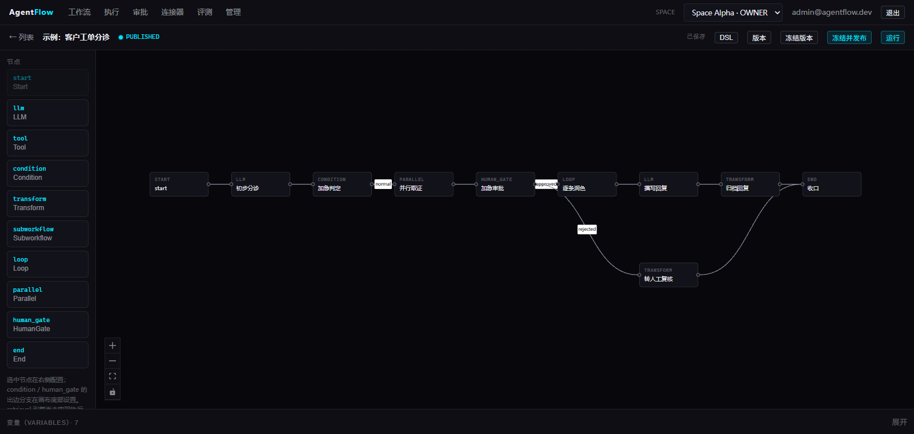
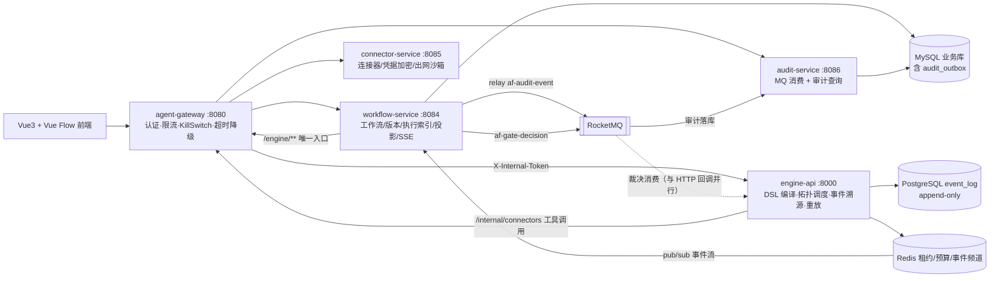

# AgentFlow · 可视化 Agent 工作流编排平台

[](https://github.com/ybw0405-study/AgentFlow/actions/workflows/java-ci.yml)
[](https://github.com/ybw0405-study/AgentFlow/actions/workflows/python-ci.yml)
[](https://github.com/ybw0405-study/AgentFlow/actions/workflows/frontend-ci.yml)
[](https://github.com/ybw0405-study/AgentFlow/actions/workflows/contract-drift.yml)
[](https://github.com/ybw0405-study/AgentFlow/actions/workflows/e2e.yml)
[](https://github.com/ybw0405-study/AgentFlow/actions/workflows/eval-nightly.yml)
[](LICENSE)

Vue3 画布拖拽编排 DAG（LLM / 工具 / 检索 / 条件 / 循环 / 人工审批），**事件溯源执行引擎**
（崩溃可恢复、副作用按 `callId` 幂等），全链路治理（租户隔离、预算硬停止、PII 双层脱敏、审计只追加）。
MCP 支持 tools / resources / prompts 三层能力与 sampling 反向调用（默认关、硬上限兜底）。



## 架构



- **事件即唯一真相**：MySQL 的 execution / node_execution 只是 PG 事件流的查询投影（Projector 轮询 + 游标）。
- **幂等与恢复**：Command 与结果成对落事件；`callId = executionId/nodeKey/attempt` 确定性幂等；Redis 租约做冲突降级；外部副作用整体语义为 at-least-once（见已知限制）。
- **预算硬停止**：发出 Command 前 Redis 预占并把 maxTokens 钳到剩余额度；结算超支追扣；并发分支下为尽力钳制，不承诺数学恒定上界。

## 快速开始

前置：Docker Desktop（`docker info` 可用）；开发模式另需 JDK 17、Node 22、Python 3.13。

```bash
# 全容器一条命令（中间件 + 5 服务 + 前端；镜像不在本地时自动从源码构建，无需本机 JDK/Maven）
AF_CONTAINERS=1 scripts/start-dev.sh
# 网关 http://127.0.0.1:8080 / 前端 http://127.0.0.1:8081

# 开发模式（宿主机进程，改代码热迭代）
scripts/start-dev.sh
```

Windows PowerShell 对应命令：

```powershell
.\scripts\start-dev.ps1 -Containers   # 全容器模式
.\scripts\start-dev.ps1               # 开发模式
```

真实模型：注入 `AF_LLM_BASE_URL` / `AF_LLM_API_KEY` / `AF_LLM_MODEL`（OpenAI 兼容端点），
或在「连接器」页建模型连接后在画布点「模型」接入；未配置时 LLM 节点明确报
`LLM-NOT_CONFIGURED-001`，不静默回落到示例文本。

## 核心能力

| 能力 | 说明 |
|---|---|
| 画布编排 | Vue Flow，12 类节点、分支连线、子图 4 层下钻、DSL 双向同步、模板与自动布局 |
| 执行引擎 | 拓扑调度、并行上限、重试、超时、取消、checkpoint、崩溃恢复重放 |
| 版本治理 | 草稿 / 发布冻结（不可变 + checksum）/ 回滚 / 灰度分桶 |
| 人工审批 | human_gate 挂起 / 恢复 / 超时裁决；审批人 ROLE / USERS / 受限表达式 |
| 触发器 | Webhook（HMAC + 幂等键 + 限流）与定时（5/6 段 cron 支持秒级，补跑策略有界补偿） |
| 连接器 | AES-256-GCM 凭据、OAuth2、出网沙箱、MCP tools/resources/prompts/sampling |
| 知识库与检索 | 建库 / 导入（纯文本 JSON + PDF/Office 上传解析）/ 切片；lexical BM25 / vector pgvector / hybrid RRF 三模式 + 可选 rerank 精排（`AF_RERANK_*`，见已知限制 9） |
| 成本中心 | 预算账本投影、月度额度、按工作流 / 按天 / 按模型分解、试跑份额 |
| 评测 | 数据集 / 用例 / 四种断言 / A/B 双版本对比；nightly 真模型冒烟 + LLM judge |
| 可观测 | SSE 实时节点状态、OTel + LangFuse（可选）、Prometheus 指标、审计只追加 |

## 真实模型评测

`eval-nightly` 每日以真实 OpenAI 兼容端点跑 LLM 节点冒烟并由 LLM judge 打分（均分 ≥ 0.8 门禁）。
最近一次触发（2026-11-24，`deepseek-chat`）：3 用例均分 **1.0**，门禁通过；报告见该 run 的
`eval-live-report` artifact。离线侧另有确定性回归 harness 与 OpenAPI 契约漂移门禁。
检索默认词法 BM25；配置 `AF_EMBEDDING_*` 后启用 pgvector 语义与 RRF 混合（懒索引、租户/模型谓词隔离）。

## 技术栈

Vue 3 + Vue Flow + TypeScript / Spring Boot 3.5 多模块（gateway / workflow / connector / audit）/
FastAPI 事件溯源引擎 / PostgreSQL event_log / MySQL 投影 / Redis 租约与预算 / RocketMQ 审计与裁决 /
MCP Streamable HTTP / OpenTelemetry + Prometheus + LangFuse（可选）/ Docker 多阶段 + GHCR /
GitHub Actions 全链路门禁。

## 已知限制

15 条能力边界与有意取舍的逐条说明见 [docs/known-limitations.md](docs/known-limitations.md)。
阅读功能矩阵前请先读它。

## 文档

- [产品与界面完整指南](docs/product-guide.md)（功能矩阵、画布交互、模型清单、用量页）
- [架构设计](docs/architecture.md)（含决策表 D1–D11）
- [迁移注释代号索引](docs/migration-comment-codes.md)
- [OpenAPI 契约基线](docs/openapi/)
- [贡献指南](CONTRIBUTING.md) / [安全策略](SECURITY.md) / [变更日志](CHANGELOG.md)

## 许可证

[MIT](LICENSE)
