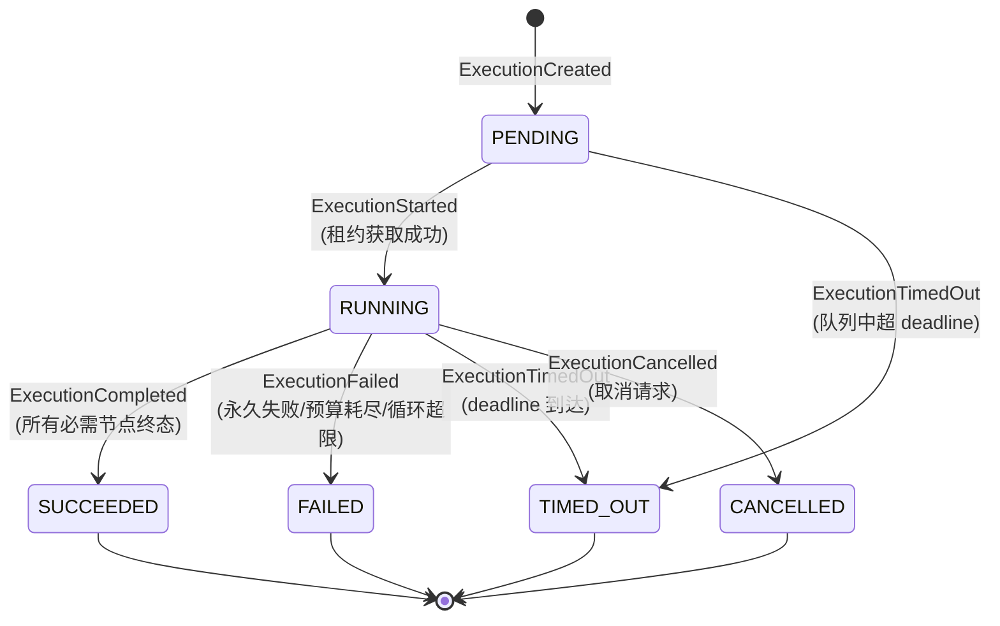
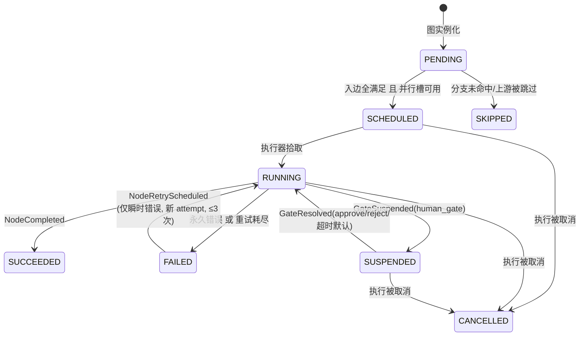

# 执行引擎

> 本文件由 `docs/architecture.md` 按主题拆分归档，正文保持原文（含原章节编号）。
> 章节索引与 `§` 交叉引用对照见 [docs/README.md](../README.md)。

## 5. 执行引擎（核心）

### 5.1 状态机

**Execution：**

**Node Execution：**

转移守卫与纪律：

- 终态（SUCCEEDED/FAILED/CANCELLED/TIMED_OUT；节点另含 SKIPPED）吸收一切后续转移。
- **禁止 FAILED → RUNNING 直接跳转**：必须落 `NodeRetryScheduled` 事件并创建新 attempt（新 `node_execution` 行，`(execution_id, node_key, attempt)` 唯一）。
- 非法转移：拒绝 + 审计 `WF-STATE-001`。
- human_gate 无论 approve/reject 都经 RUNNING → SUCCEEDED，输出 `decision`，下游按 `branch=approved|rejected` 的边分流（与 condition 语义统一）。
- 执行被取消时，未开始的节点转 CANCELLED；运行中节点允许当前 Command 收尾后停。

### 5.2 事件目录（§6.2 核心集 + 扩展事件（标 `ex`，均有条款依据））

| 事件 | 级别 | payload 关键字段 | 依据 |
|---|---|---|---|
| ExecutionCreated | 执行 | definitionId, versionId, tenantId/spaceId, triggeredBy, idempotencyKey, policy{tokenBudget,maxSteps,deadlineMs,clamped}, variablesDigest, traceId | 核心 |
| ExecutionStarted `ex` | 执行 | workerId, leaseId, startedAt | 恢复/租约观测 |
| ExecutionCompleted | 执行 | result, tokenUsed, stepsUsed, durationMs | 核心 |
| ExecutionFailed | 执行 | errorCode, message(脱敏), failedNodeKey, tokenUsed, stepsUsed | 核心 |
| ExecutionTimedOut `ex` | 执行 | phase(QUEUE/RUNNING), deadlineAt | 状态机完备性 |
| ExecutionCancelled | 执行 | requestedBy, reason | 核心 |
| CheckpointCreated | 执行 | completedNodes[], variablesSnapshot(脱敏), tokenUsed, stepsUsed | 核心（每 10 事件） |
| NodeScheduled | 节点 | nodeKey, nodeType, attempt, dependsOn[] | 核心 |
| NodeStarted | 节点 | nodeKey, attempt, inputDigest | 核心 |
| NodeCompleted | 节点 | nodeKey, attempt, **output（完整·已脱敏）**, outputDigest, tokenUsed, latencyMs | 核心 |
| NodeFailed | 节点 | nodeKey, attempt, errorCode, class(PERMANENT/TRANSIENT), retryable, latencyMs | 核心 |
| NodeRetryScheduled `ex` | 节点 | nodeKey, nextAttempt, delayMs, cause | §8.4 重试 |
| NodeSkipped `ex` | 节点 | nodeKey, reason(BRANCH_NOT_TAKEN/UPSTREAM_SKIPPED), byNodeKey | SKIPPED 必须可见 |
| NodeSuspended `ex` | 节点 | nodeKey, reason | 状态机完备性 |
| GateSuspended | 节点 | nodeKey, approversRule, timeoutAt, defaultBranch | 核心（P3） |
| GateResolved | 节点 | nodeKey, decision(APPROVED/REJECTED/TIMEOUT), resolvedBy | 核心（P3） |
| CommandIssued `ex` | 命令 | nodeKey, attempt, **callId**, kind(LLM/TOOL/RETRIEVAL), requestDigest | §8.2.3 命令成对落事件 |
| CommandCompleted `ex` | 命令 | callId, responseDigest, tokenUsed, latencyMs | §8.2.3 |
| CommandFailed `ex` | 命令 | callId, errorCode, class, latencyMs | §8.2.3 |

`aggregate_version` 每 execution 从 1 严格递增；追加时带期望值，冲突则重读重放后重试 ≤3 次。`callId = {executionId}/{nodeKey}/{attempt}`。

### 5.3 确定性重放协议

1. 恢复流程：取租约 → 按 `aggregate_version` 顺序读全部事件 → 还原内存状态（已完成节点输出、变量快照、预算消耗、取消标记）→ 从最近 Checkpoint 加速 → 续跑。
2. 重放时：已 `NodeCompleted` 的节点**直接注入事件中的 output**，不调用模型/工具；有 `CommandCompleted` 的 callId 复用结果；有 `CommandIssued` 无 `CommandCompleted` 的，用**同一 callId** 重发（下游幂等去重）。
3. 恰好一次的论证：副作用发出前必落 `CommandIssued`；callId 确定性派生；mock/connector 按 callId 去重（Redis `SET NX` + 结果缓存）；事件追加有乐观锁兜底；租约只做冲突降级，不做正确性保证。
4. 节点内禁止 `Date.now()`/`random()`/读环境变量：时间由 `ExecutionContext.now()` 注入，随机数由 `sha256(executionSeed + nodeKey + attempt)` 派生。
5. 取消协议：取消请求 → 控制面写 MySQL + 调 engine `/cancel` → engine 落 `ExecutionCancelled`（若租约不在手则经 Redis 取消标记 + 兜底 re-drive）；执行器在节点边界与 Command 发出前检查。

### 5.4 调度语义

- 编译期：DSL → DAG；校验环、悬空引用、未定义变量、重复 nodeKey、非法分支；失败 422 并给出节点路径（错误码见 §8）。
- 运行期：拓扑分层；同层并行受 `maxParallelism`（默认 4）；入边全满足才 `NodeScheduled`。
- condition：仅命中分支的出边激活；未命中分支下游传播 SKIPPED（保留在执行树）。
- loop：迭代实例键 `loopKey#i`，体内节点键 `loopKey#i/innerKey`；超 `maxIterations` 即 `FAILED` + `EXEC-LOOP_LIMIT_EXCEEDED`，已完成迭代结果保留在事件中。
- parallel：分支并发受 `maxConcurrency`；join=`all` 等待全部，`first_success` 首个成功即合并、其余分支允许收尾后忽略（不再发新 Command）。
- subworkflow：子执行是独立 execution（独立预算，父级扣减 `maxTokens` 上界），父节点等待子执行终态。
- 永久/瞬时错误分类：永久（DSL/参数/权限/PII 命中/表达式错误）不重试；瞬时（超时/限流/5xx）指数退避 ≤3 次。节点 `timeoutMs` 与执行 `deadlineMs` 双约束，到期前停止发新 Command。

### 5.5 租约

`af:lease:{executionId}` = `SET NX PX=30000`，value=workerId+leaseId；每 10s 续约；**每次事件追加前**校验租约仍归属自己（GET 比对）；租约丢失 → 停止写事件并退出。正确性兜底是 `aggregate_version` 乐观锁（租约冲突场景）。

### 5.6 预算硬停止

发出 Command 前：`remaining = tokenBudget - tokenUsed`；`remaining ≤ 0` → `ExecutionFailed{errorCode: EXEC-BUDGET_EXHAUSTED}`，不再发任何 Command；否则该 Command 的 `maxTokens := min(node.maxTokens, remaining)`，Redis 预占；完成时按实际 `tokenUsed` 结算回冲。MySQL `budget_ledger` 由 projector 异步对账。

### 5.7 LLM Provider（真实模型）

`LlmExecutor` 只依赖 `LLMProvider` 协议（`complete(...) -> CommandResult`），注册表在应用装配期注入：

| provider | 端点来源 | 语义 |
|---|---|---|
| `openai-compatible` | 仅来自 `AF_LLM_*` 环境变量 | 任意 OpenAI 兼容 `/chat/completions`（DeepSeek / Qwen / OpenAI / 本地 Ollama 等） |
| `connector` | 节点配置 `connectionId` 指向的模型连接 | 引擎 → connector-service `/internal/connectors/{id}/invoke` 的 `chat` 操作；端点与密钥由服务端解密注入 |

产品装配只注册上面两条路径；离线 provider 已从 `app/` 移除，单元测试用 `tests/support/` 里的夹具自行注入。

**模型连接（三路径中的首选）**：`tool_connector` 里 `type=LLM` 的一条记录即一条模型连接，
`config` 声明 `baseUrl` / `allowedHosts` / `auth{headerName,valuePrefix}` /
`operations{chat,models}`，密钥走既有的 `tool_credential`（AES-256-GCM，AAD 绑定
`connectorId|tenantId`）。节点只持 `connectionId`，因此：

- 密钥与 URL 不进 DSL、不进画布、不进事件载荷；换密钥或换端点不需要动工作流、不需要重启引擎。
- 出网仍过 `SandboxPolicy`（白名单 + 私网拦截 + DNS rebinding 复核），与工具连接器同一套口径。
- `callId` 由引擎按 `execution_id|node_key|attempt` 确定性派生，崩溃重放会命中
  connector-service 的 `af:conncall:*` 幂等缓存，不重复出网（把 §5.3 的 at-least-once 拉回接近一次）。
- 模型清单由 `POST /api/v1/connectors/{id}/models/probe` 现场拉取，服务端解密凭据后请求一次
  `/models`，响应只含模型 id；失败按错误码分类（4xx/5xx/凭据缺失/沙箱拦截/非 OpenAI 格式）。

信任边界：

- **端点与密钥绝不来自 DSL 或用户入参**：走连接时 URL 与凭据只存在于 connector-service 的记录里（密文），
  走进程级配置时只在 engine-api 装配期从环境变量读取。两条路径都不允许调用方指定 URL，杜绝 SSRF 与凭据注入；
  密钥仅出现在 `Authorization` 头，日志/错误体/事件载荷一律脱敏（单测覆盖）。
- `AF_PRODUCTION=true` 时强制要求 https 端点（`AF_LLM_ALLOW_INSECURE_HTTP` 仅本地调试例外）。
- PII 第二层脱敏仍在 `LlmExecutor` 内先于 provider 执行；provider 不感知原始 prompt 之外的任何租户数据。
- 输入侧历史占位模型名自动回落（进程级回落到 `AF_LLM_MODEL`，连接回落到该连接的 `defaultModel`），避免旧草稿切到真实端点时上游 400。
- 回落只改变实际下发的模型名，不改变审计事实：`output.model` 与 `CommandCompleted` 记录**真实**模型名；声明值与实际值不一致时另存 `requestedModel`，事后可追「配了什么、跑了什么」。
- 连接器错误码在执行详情里翻译成模型语义（`CONN-CREDENTIAL-*` → `LLM-CREDENTIAL-001`、`CONN-NOT_FOUND/DISABLED/SANDBOX` → `LLM-CONNECTION-001`、`CONN-HTTP-5XX/TIMEOUT` → 瞬时），避免把内部编码暴露给使用者，同时保证瞬时性判定正确。

**模型清单**：画布有两处来源。走连接时由 `POST /api/v1/connectors/{id}/models/probe` 现场拉取（服务端解密凭据后请求该连接的 `/models`）；走进程级时由引擎 `GET /internal/llm/models` 提供，经 workflow-service 转发为 `GET /api/v1/llm/models`（JWT 保护）。两处响应都只含模型 id 与默认模型名；未配置端点时返回 `configured=false` 而非报错，上游不可用时返回错误码让前端退回手填。密钥与 base_url 永不出现在响应里，也不会被拼进任何 URL 由调用方指定。

**重试分层**：provider 不做重试，只把上游状态精确分类为瞬时/永久（`LLM-RATE_LIMIT-001` / `LLM-TIMEOUT-001` / `LLM-UPSTREAM-001` 为瞬时；`LLM-AUTH-001` / `LLM-REQUEST-001` / `LLM-RESPONSE-001` / `LLM-NOT_CONFIGURED-001` 为永久）。重试由 §5.4 的引擎 RetryPolicy 统一执行，避免双层重试导致重复计费。

**逐 token 流式（opt-in）**：`AF_LLM_STREAM=true` 时，直连 `openai-compatible` 路径对纯文本模式开启 SSE 逐 token 流式。上游增量以 `OutputDelta` 事件逐个推送（`COMMAND_ISSUED → OutputDelta* → COMMAND_COMPLETED`），供前端做「打字机」展示。三条不变式保证这是**纯展示层增强、不改节点语义**：

- 流式与非流式返回的 `CommandResult.data` / `usage` 完全一致；`OutputDelta` 只出现在 `CommandCompleted` 之前，下游 condition / JSON 校验 / 变量引用仍只消费完整结果。
- JSON 输出模式（`output_mode=json`）强制非流式——schema 校验需要完整结果，流式无法保证 JSON 合法性。
- 连接器路径（`connector`）不流式：它经 connector-service 单跳代理（256KB 裁剪、非流式 JSON 信封），拿不到 SSE 增量，保持非流式是明确边界，不影响可用性。

连接器路径不流式的**技术依据**（不是未实现，而是架构冲突）：`ConnectorInvoker.invoke` 是同步阻塞调用（`HttpClient.send` 一次性收全响应体），结果经 `BoundedBodyReader` 裁剪到 256KB 后以 JSON 写入 Redis 幂等缓存（`af:conncall:*`），再由同步 `@PostMapping` 一次性返回。流式与这套模型在三个层面根本冲突——(1) SSE 增量无法塞进「一次 JSON 结果 + 幂等缓存重放」的形态；(2) 流无法在崩溃后按 callId 从缓存重放，幂等语义需另造一套；(3) 响应裁剪与 `InvokeResult` 同步返回都是「整包」假设。要支持流式需新增一条独立的流式透传通道（connector-service 的 `SseEmitter`/`Flux` 端点 + 上游 `BodyHandlers.ofLines` 流读 + 网关 SSE 透传 + Python 侧流式客户端），且与现有幂等/裁剪语义并存时需重新设计边界。当前定位为**明确不覆盖**，而非缺陷；确有需求时按上述通道独立演进。

默认关闭（`AF_LLM_STREAM` 缺省 `false`），避免对不支持流式或行为有差异的上游造成回归。

**与 §5.3 的差异（必须知晓）**：真实模型是外部非确定性副作用，且上游普遍不支持按 callId 幂等去重。因此 §5.3 的「恰好一次」论断对真实 provider 降级为 **at-least-once**：`CommandIssued` 已落但 `CommandCompleted` 未落时崩溃恢复会重发调用，可能产生重复计费。`AF_LLM_SEND_SEED=true` 可向上游传递确定性 seed 提高复现性，但不构成幂等保证。需要强幂等时应接入支持 idempotency key 的上游，或在 connector 层加结果缓存。

**MCP 工具来源（`type=MCP`）**：`tool_connector` 的第三种类型，把远端 MCP（Model Context Protocol）
服务接进既有 tool 节点，DSL 与引擎零改动——`operation` 填 MCP 工具名，`params_mapping` 渲染结果即
`tools/call` 的 `arguments`。传输只实现 **Streamable HTTP**（单端点 JSON-RPC 2.0 POST）：
`initialize` 协商版本（支持 `2025-03-26` / `2025-06-18`，未知版本拒绝）→ `notifications/initialized`
→ `tools/call`；响应兼容 `application/json` 与 `text/event-stream` 两种形态（SSE 逐帧解出匹配 id 的
响应即止，不等 EOF）。**不实现 stdio**：拉起本地进程超出出网沙箱的治理面。

- 治理完全复用：`baseUrl` 即 JSON-RPC 端点，过 `SandboxPolicy`（白名单 + 私网拦截 + rebinding 复核），
  凭据走 `tool_credential` 同一套 AES-256-GCM 注入请求头，响应经 `BoundedBodyReader` 裁剪 256KB，
  结果按 `callId` 写 `af:conncall:*` 幂等缓存——崩溃重放不重复出网。
- 会话：`Mcp-Session-Id` 随初始化响应建立，后续请求携带；带会话的请求收到 404 视为会话过期，
  透明重建一次再重发。无状态服务端（不下发 session）同样支持。多次往返共享同一 `timeoutMs` 预算。
- 错误码：`CONN-MCP-001`（协议损坏/版本未知，永久）、`CONN-MCP-002`（JSON-RPC error；仅 -32603
  内部错误瞬时）、`CONN-TOOL-001`（工具结果 `isError=true`，永久，`data` 保留 `content` 供下游判读）；
  HTTP 层沿用 `CONN-HTTP-4XX/5XX`、`CONN-REDIRECT-001`、`CONN-TIMEOUT`、`CONN-SANDBOX-001` 等。
- 工具清单由 `POST /api/v1/connectors/{id}/mcp/tools` 现场拉取（分页上限 5 页 / 200 条，
  name/description 截断），只回 name/description/inputSchema；连接器页「拉取工具」与创建后自动探测共用它。
- 与连接器路径不流式的边界一致：MCP 的 SSE 仅用于**取回单个 JSON-RPC 响应**，不做逐 token 透传；
  节点语义仍是「一次调用、整包结果、可按 callId 重放」。

**MCP 非工具能力（resources / prompts）**：新增 DSL 节点 `mcp`（`capability=resource|prompt`），
tools 仍走 tool 节点，一个节点类型不承载两种语义。内部 invoke 契约加可选 `mcpMethod`
（`tools/call|resources/read|prompts/get`，缺省 tools/call），不用 operation 魔法前缀，避免与真实工具名撞车。
resource 以 `uri` 定位（模板字符串可用），prompt 以 `promptName` + `argumentsMapping` 定位；
两者互斥由 DSL 校验保证。结果归一化：`contents`/`messages` 原样保留，另拼 `text`
（prompt 带角色前缀）供下游 llm 节点直接引用；blob/image 等非文本 part 不进 `text`，
超 256KB 整调用拒绝（`CONN-RESPONSE-TOO_LARGE`），不静默截断。
清单探测 `POST /connectors/{id}/mcp/resources`、`/mcp/prompts` 与工具清单同口径
（5 页 / 200 条 / 串截断），连接器页「拉取清单」一次汇总三类能力。
治理与 tools 完全同链路：授权校验、callId 幂等、沙箱、凭据注入、瞬时/永久分类、可试跑。

**MCP sampling（服务端反向借模型，默认关）**：MCP 连接配置 `sampling.connectorId` 指向
**同租户链内启用的 LLM 连接器**才启用（创建/更新时校验，拒自指、拒跨租户、拒非 LLM），
initialize 才声明 `capabilities.sampling`。服务端在 tools/call 的 **SSE 流**里发
`sampling/createMessage` 时，connector-service 同步把消息转成 OpenAI chat 载荷
（text part 直取、resource 文本内联、image/audio 跳过），经既有 `invoke` 借该 LLM 连接器回答
（缓存/NX 锁/沙箱/凭据/租户链全复用；子 callId 与父不同不自锁），回包后续读原响应。
硬上限：每调用请求数默认 4 上限 8、`max_tokens` 默认 1024 上限 4096（配置越界创建时拒绝）、
共享同一 deadline；未配置/超帽/目标不可用回 JSON-RPC -32601 让服务端降级，LLM 失败回 -32603。
计量元数据 `{requests, promptTokens, completionTokens}` 随工具结果回传。
**已知限制**：sampling 成本不进引擎预算账本（靠硬上限兜底）；仅支持服务端以 SSE 回应 tools/call
的形态（纯 JSON 响应承载不了反向请求）；text-only；嵌套 LLM 调用与父共享 wall-clock 预算。

---

