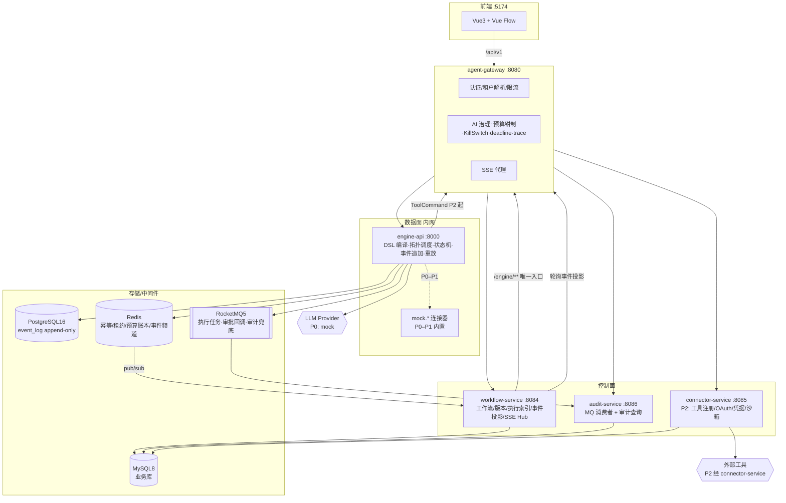

# 系统架构与模块边界

> 本文件由 `docs/architecture.md` 按主题拆分归档，正文保持原文（含原章节编号）。
> 章节索引与 `§` 交叉引用对照见 [docs/README.md](../README.md)。

## 1. 系统架构



组件与端口：

| 组件 | 端口 | 说明 |
|---|---|---|
| agent-gateway | 8080 | 唯一对外入口；`/api/v1/**` 业务路由，`/engine/**` 内部路由（仅服务间） |
| workflow-service | 8084 | 工作流/版本/执行索引/审批/事件投影/SSE Hub |
| connector-service | 8085 | P2 加入；P0–P1 由 engine 内置 mock 连接器替代 |
| audit-service | 8086 | RocketMQ 消费者 + `/admin/audit` 查询 |
| engine-api | 8000 | 仅内网；拒绝无 `X-Internal-Token` 请求 |
| 前端 dev | 5174 | Vite dev server（IPv4 `127.0.0.1`，`strictPort`），代理到 8080；避开常被其他项目占用的 5173 |

---

## 2. 模块边界与依赖方向（硬性）

### 2.1 Java（Maven 多模块）

```
agentflow-parent
├── common            # DTO/错误码/ProblemDetail/trace/tenant/pii-v2/幂等组件/JWT
├── agent-gateway     # 路由、安全过滤器、治理过滤器；只依赖 common
├── workflow-service  # 依赖 common；调用 engine 只能经 gateway（ArchUnit 强制）
└── audit-service     # 依赖 common；MQ 消费者 + 审计查询
```

ArchUnit 规则（CI 执行，违反即红）：

1. `workflow-service` 任何类不得出现 engine-api 主机字面量；对 engine 的 HTTP 调用只能经 `EngineGatewayClient`，其 base URL 只允许指向 gateway。
2. 分层：`controller → service → repo`，反向依赖禁止；`repo` 不得依赖 `service`。
3. `common` 不得依赖任何业务模块。
4. `audit_event` 的写入只能出现在 `audit-service` 的 `..consumer..` 包。
5. Maven 模块间禁止循环依赖。

### 2.2 Python（engine-api 包）

```
app/
├── api/          # FastAPI 路由（/internal/**、health、metrics）——薄层，不含业务
├── dsl/          # Pydantic v2 模型、校验、编译为 DAG
├── engine/       # 调度器、状态机、重放、租约、checkpoint、取消、dispatcher
├── nodes/        # 11 种节点实现；只发 Command，不直接做副作用
├── commands/     # Command 对象 + Provider 注册表 + mock providers
├── events/       # 事件追加（乐观并发）、重放、Redis 发布、tracker
├── governance/   # token 计量、预算账本、PII 第二层
├── expression/   # simpleeval 白名单、Jinja2 沙箱
└── observability/# OTel、Prometheus、结构化日志
```

依赖规则（Ruff/flake8-import-order + 自定义 CI 检查）：`api → engine → nodes → commands → events`；`nodes` 与 `engine` 不得 import FastAPI；PG 写入只能出现在 `events/`；Redis 访问只能出现在 `events/`、`governance/`、`engine/lease.py`。

### 2.3 前端

```
src/
├── api/        # OpenAPI 生成客户端（提交入库）+ SSE 封装
├── dsl/        # DSL TS 类型、Vue Flow ↔ DSL 双向转换、客户端预校验
├── stores/     # auth / workflows / executions / ui
├── views/      # Login, WorkflowList, CanvasEditor, Versions,
│               # ExecutionDetail, ExecutionList, Connectors(P2), Admin
├── components/ # canvas/ nodes/ drawers/ execution/ common/
└── design/     # tokens.css（暗物质：#08080C/#0E0E14/#00E5FF，禁绿色）
```

ESLint + vue-tsc --strict + Vitest；禁止 `any`（确需时行内注释说明）。

---

