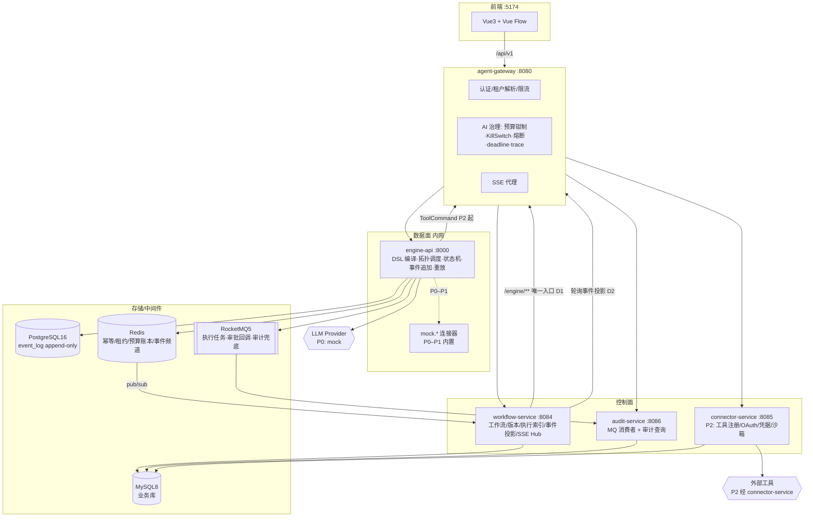
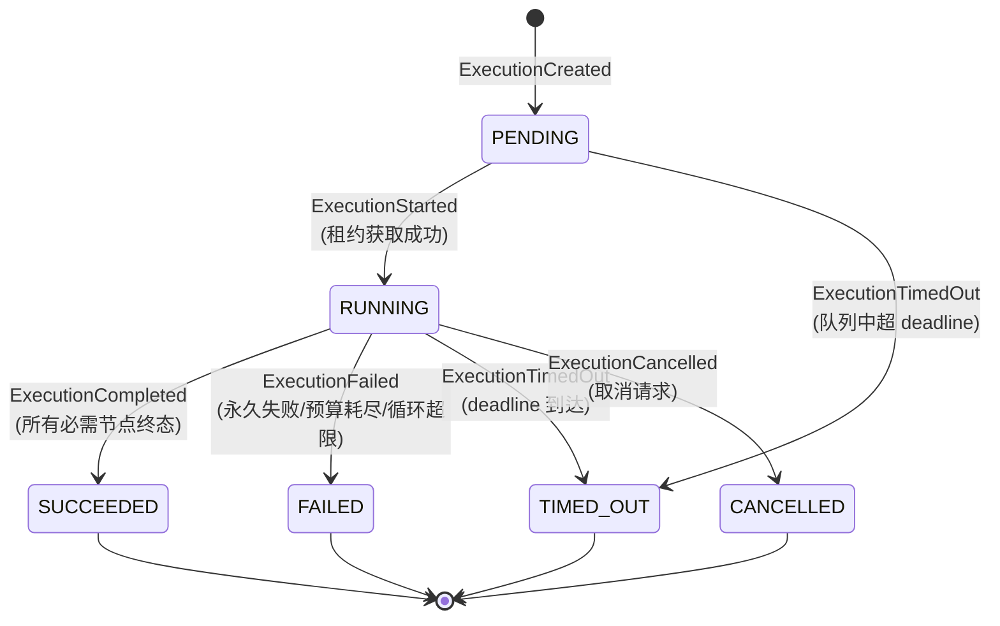
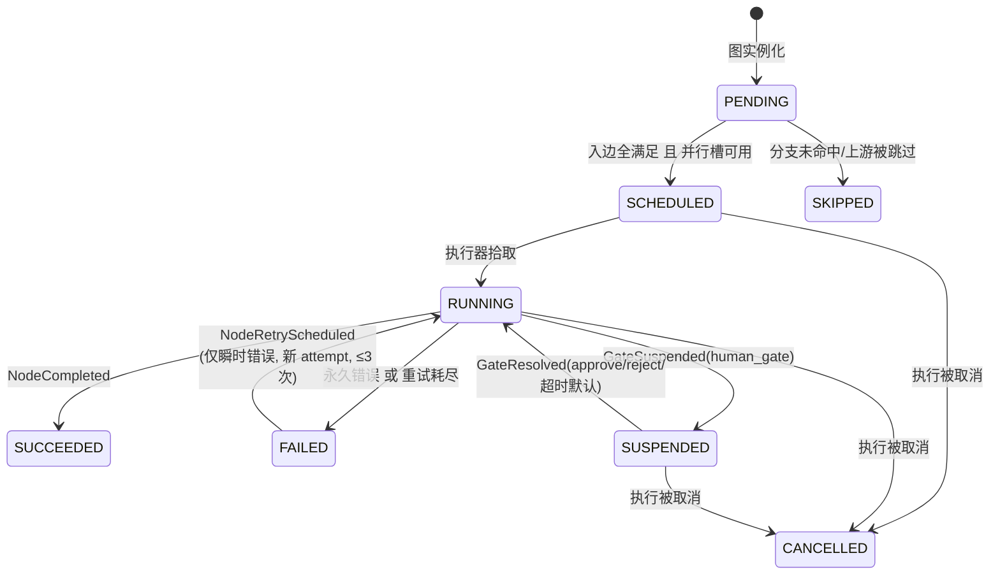

# AgentFlow 架构设计文档

> 版本：v1.0（已确认）｜状态：**架构已锁定，进入 P0 实现**
> 本文档是 P0–P3 全部实现的契约。任何实现与本文件冲突时，先改文档再改代码。

---

## 0. 关键设计决策记录（ADR 摘要）

| # | 决策 | 理由 |
|---|---|---|
| D1 | Java 侧对 Python 的唯一调用路径：workflow-service → gateway 内部路由 `/engine/**` → engine-api。engine-api 仅监听内网网卡，所有 internal 调用要求 `X-Internal-Token` + `traceparent` | 满足 §5.2「唯一调用入口」与 ArchUnit 依赖方向；治理（超时/熔断/deadline）集中在 gateway |
| D2 | 事件回流三通道：① 权威投影 = workflow-service Projector 轮询 engine `GET /internal/events?afterSeq=`（游标存 MySQL `projector_cursor`）；② 实时推送 = engine 追加事件后发布 Redis 频道 `af:exec-events`（at-most-once），SSE Hub 订阅扇出，断线用 `afterSeq` 追平；③ 审计兜底 = Projector 转发 RocketMQ `af.audit.events` | PG 由 Python 独占写入，Java 不直连事件库；SSE 不依赖 MQ 即可低延迟；MQ 只兜审计 |
| D3 | 工具副作用路径：P0–P1 用 engine 内置 `mock.*` 连接器（开发装置，无凭据、无外网，调用计数落 Redis，按 `callId` 去重）；P2 起真实工具调用由 engine 发 `ToolCommand` → gateway → connector-service 执行，**凭据只在 connector-service 解密，Python 永不见明文** | 满足 §5.2「Python 绝不可以直连外部服务明文凭据」，同时让 P0 的 tool 节点可演示 |
| D4 | 崩溃恢复：engine 启动时扫描自有 PG 表 `execution_tracker`（非终态 execution），逐个尝试获取租约续跑；workflow-service 另设兜底任务，对 MySQL 中超期 RUNNING 的执行做幂等 re-drive | 恢复不依赖业务库；双保险 |
| D5 | `execution_event.payload` 口径：`NodeCompleted.payload.output` 存**完整且已脱敏**的输出（重放所需），其余事件存摘要+digest；原始提示词全文、未脱敏内容永不入事件；单事件 payload 上限 256KB，溢出落 `node_io` 并仅在事件存引用+digest | 调和 §6.2「只含摘要」与 §6.3「重放所需全部字段」 |
| D6 | 主键统一 UUID（CHAR(36)）；每张需分页/排序的表另加 `seq BIGINT AUTO_INCREMENT UNIQUE` 作为游标 | UUID 不可排序，cursor 分页需要稳定序 |
| D7 | 软删除唯一约束用 MySQL 8 生成列模式：`uq_x = IF(deleted_at IS NULL, <col>, NULL)`，唯一索引建在生成列上 | MySQL 唯一索引中 NULL 互不相等，普通复合唯一索引无法约束未删除行 |
| D8 | 灰度发布：`workflow_definition.traffic_json = [{versionId, weight}]`，触发时按 `hash(idempotencyKey)` 确定性分桶选版本；NULL = 100% current | 同一幂等键永远路由同一版本，天然防重 |
| D9 | retrieval 节点走 `RetrievalProvider` 抽象；P0 提供 mock provider（离线固定语料），P2 接 pgvector / DocQA RAG 服务 | §4 栈未列 pgvector，P0 须可离线演示 |
| D10 | 表达式引擎用 simpleeval 白名单（禁下划线属性、禁 import、禁 lambda）；模板用 Jinja2 `SandboxedEnvironment`；CI 用 Ruff S 规则 + grep 禁 `eval`/`exec` | §9 安全约束 |
| D11 | 预算硬停止实现：发出任何 Command 前，引擎用 Redis 原子 `INCRBY` 预占 `min(node.maxTokens, 剩余预算)`，并把该 Command 的 `maxTokens` 钳到剩余额度；完成后按实际结算回冲预占 | 保证 `tokenUsed ≤ tokenBudget` 恒成立（US-05） |

---

## 1. 系统架构



组件与端口：

| 组件 | 端口 | 说明 |
|---|---|---|
| agent-gateway | 8080 | 唯一对外入口；`/api/v1/**` 业务路由，`/engine/**` 内部路由（仅服务间） |
| workflow-service | 8084 | 工作流/版本/执行索引/审批/事件投影/SSE Hub |
| connector-service | 8085 | P2 加入；P0–P1 由 engine 内置 mock 连接器替代（D3） |
| audit-service | 8086 | RocketMQ 消费者 + `/admin/audit` 查询 |
| engine-api | 8000 | 仅内网；拒绝无 `X-Internal-Token` 请求 |
| 前端 dev | 5174 | Vite dev server（IPv4 `127.0.0.1`，`strictPort`），代理到 8080；避开常被其他项目占用的 5173 |

---

## 2. 模块边界与依赖方向（硬性）

### 2.1 Java（Maven 多模块）

```
agentflow-parent
├── common            # DTO/错误码/ProblemDetail/trace/tenant/pii-v2/幂等组件/JWT
├── agent-gateway     # 路由、安全过滤器、治理过滤器；只依赖 common
├── workflow-service  # 依赖 common；调用 engine 只能经 gateway（ArchUnit 强制）
└── audit-service     # 依赖 common；MQ 消费者 + 审计查询
```

ArchUnit 规则（CI 执行，违反即红）：

1. `workflow-service` 任何类不得出现 engine-api 主机字面量；对 engine 的 HTTP 调用只能经 `EngineGatewayClient`，其 base URL 只允许指向 gateway。
2. 分层：`controller → service → repo`，反向依赖禁止；`repo` 不得依赖 `service`。
3. `common` 不得依赖任何业务模块。
4. `audit_event` 的写入只能出现在 `audit-service` 的 `..consumer..` 包。
5. Maven 模块间禁止循环依赖。

### 2.2 Python（engine-api 包）

```
app/
├── api/          # FastAPI 路由（/internal/**、health、metrics）——薄层，不含业务
├── dsl/          # Pydantic v2 模型、校验、编译为 DAG
├── engine/       # 调度器、状态机、重放、租约、checkpoint、取消、dispatcher
├── nodes/        # 11 种节点实现；只发 Command，不直接做副作用
├── commands/     # Command 对象 + Provider 注册表 + mock providers
├── events/       # 事件追加（乐观并发）、重放、Redis 发布、tracker
├── governance/   # token 计量、预算账本、PII 第二层
├── expression/   # simpleeval 白名单、Jinja2 沙箱
└── observability/# OTel、Prometheus、结构化日志
```

依赖规则（Ruff/flake8-import-order + 自定义 CI 检查）：`api → engine → nodes → commands → events`；`nodes` 与 `engine` 不得 import FastAPI；PG 写入只能出现在 `events/`；Redis 访问只能出现在 `events/`、`governance/`、`engine/lease.py`。

### 2.3 前端

```
src/
├── api/        # OpenAPI 生成客户端（提交入库）+ SSE 封装
├── dsl/        # DSL TS 类型、Vue Flow ↔ DSL 双向转换、客户端预校验
├── stores/     # auth / workflows / executions / ui
├── views/      # Login, WorkflowList, CanvasEditor, Versions,
│               # ExecutionDetail, ExecutionList, Connectors(P2), Admin
├── components/ # canvas/ nodes/ drawers/ execution/ common/
└── design/     # tokens.css（暗物质：#08080C/#0E0E14/#00E5FF，禁绿色）
```

ESLint + vue-tsc --strict + Vitest；禁止 `any`（确需时行内注释说明）。

---

## 3. 数据模型（完整 DDL）

### 3.1 MySQL（库 `agentflow`，utf8mb4，Flyway 管理，迁移一旦合入禁止修改）

```sql
-- V001__tenant_user_auth.sql ------------------------------------------------
CREATE TABLE tenant (
  id          CHAR(36)     NOT NULL,
  name        VARCHAR(128) NOT NULL,
  type        ENUM('ORG','TEAM','SPACE') NOT NULL,
  parent_id   CHAR(36)     NULL,
  created_at  DATETIME(3)  NOT NULL DEFAULT CURRENT_TIMESTAMP(3),
  updated_at  DATETIME(3)  NOT NULL DEFAULT CURRENT_TIMESTAMP(3) ON UPDATE CURRENT_TIMESTAMP(3),
  deleted_at  DATETIME(3)  NULL,
  uq_parent   VARCHAR(36)  GENERATED ALWAYS AS (IF(deleted_at IS NULL, IFNULL(parent_id,''), NULL)) VIRTUAL,
  uq_name     VARCHAR(128) GENERATED ALWAYS AS (IF(deleted_at IS NULL, name, NULL)) VIRTUAL,
  PRIMARY KEY (id),
  UNIQUE KEY uq_tenant_parent_name (uq_parent, uq_name),
  KEY idx_tenant_parent (parent_id)
);

CREATE TABLE app_user (                                  -- 复用 DocQA 结构
  id            CHAR(36)     NOT NULL,
  email         VARCHAR(255) NOT NULL,
  password_hash VARCHAR(100) NOT NULL,                   -- bcrypt
  display_name  VARCHAR(128) NULL,
  status        ENUM('ACTIVE','DISABLED') NOT NULL DEFAULT 'ACTIVE',
  created_at    DATETIME(3)  NOT NULL DEFAULT CURRENT_TIMESTAMP(3),
  updated_at    DATETIME(3)  NOT NULL DEFAULT CURRENT_TIMESTAMP(3) ON UPDATE CURRENT_TIMESTAMP(3),
  deleted_at    DATETIME(3)  NULL,
  uq_email      VARCHAR(255) GENERATED ALWAYS AS (IF(deleted_at IS NULL, email, NULL)) VIRTUAL,
  PRIMARY KEY (id),
  UNIQUE KEY uq_user_email (uq_email)
);

CREATE TABLE refresh_token (                             -- 复用 DocQA 轮换模型
  id         CHAR(36)    NOT NULL,
  user_id    CHAR(36)    NOT NULL,
  token_hash CHAR(64)    NOT NULL,                       -- sha256(token)
  family_id  CHAR(36)    NOT NULL,                       -- 轮换族；重用检测
  expires_at DATETIME(3) NOT NULL,
  revoked_at DATETIME(3) NULL,
  created_at DATETIME(3) NOT NULL DEFAULT CURRENT_TIMESTAMP(3),
  PRIMARY KEY (id),
  UNIQUE KEY uq_rt_hash (token_hash),
  KEY idx_rt_user (user_id),
  KEY idx_rt_family (family_id)
);

CREATE TABLE tenant_member (
  tenant_id  CHAR(36) NOT NULL,
  user_id    CHAR(36) NOT NULL,
  role       ENUM('OWNER','ADMIN','EDITOR','VIEWER') NOT NULL,
  inherited  TINYINT(1) NOT NULL DEFAULT 0,              -- 由上级租户继承
  created_at DATETIME(3) NOT NULL DEFAULT CURRENT_TIMESTAMP(3),
  PRIMARY KEY (tenant_id, user_id),
  KEY idx_tm_user (user_id)
);

-- V002__workflow.sql ------------------------------------------------------------
CREATE TABLE workflow_definition (
  id                 CHAR(36)     NOT NULL,
  tenant_id          CHAR(36)     NOT NULL,              -- 归属 Space
  name               VARCHAR(128) NOT NULL,
  description        VARCHAR(1024) NULL,
  status             ENUM('DRAFT','PUBLISHED','ARCHIVED') NOT NULL DEFAULT 'DRAFT',
  current_version_id CHAR(36)     NULL,                  -- 应用层维护，不加 FK（成环）
  draft_dsl          JSON         NULL,                  -- 可覆盖的草稿
  draft_checksum     CHAR(64)     NULL,
  draft_updated_at   DATETIME(3)  NULL,
  traffic_json       JSON         NULL,                  -- P1 灰度 [{versionId,weight}]
  created_by         CHAR(36)     NOT NULL,
  created_at         DATETIME(3)  NOT NULL DEFAULT CURRENT_TIMESTAMP(3),
  updated_at         DATETIME(3)  NOT NULL DEFAULT CURRENT_TIMESTAMP(3) ON UPDATE CURRENT_TIMESTAMP(3),
  deleted_at         DATETIME(3)  NULL,
  uq_name            VARCHAR(128) GENERATED ALWAYS AS (IF(deleted_at IS NULL, name, NULL)) VIRTUAL,
  PRIMARY KEY (id),
  UNIQUE KEY uq_wf_tenant_name (tenant_id, uq_name),
  KEY idx_wf_tenant_status (tenant_id, status),
  KEY idx_wf_current_version (current_version_id)
);

CREATE TABLE workflow_version (
  id            CHAR(36)    NOT NULL,
  definition_id CHAR(36)    NOT NULL,
  version_no    INT         NOT NULL,
  dsl_json      JSON        NOT NULL,
  dsl_checksum  CHAR(64)    NOT NULL,                    -- sha256(canonical(dsl_json))
  immutable     TINYINT(1)  NOT NULL DEFAULT 1,          -- 冻结即不可变
  published_at  DATETIME(3) NULL,
  published_by  CHAR(36)    NULL,
  created_by    CHAR(36)    NOT NULL,
  created_at    DATETIME(3) NOT NULL DEFAULT CURRENT_TIMESTAMP(3),
  PRIMARY KEY (id),
  UNIQUE KEY uq_wv_def_ver (definition_id, version_no),
  KEY idx_wv_def (definition_id),
  KEY idx_wv_checksum (dsl_checksum),
  CONSTRAINT fk_wv_def FOREIGN KEY (definition_id) REFERENCES workflow_definition(id)
);

DELIMITER $$
CREATE TRIGGER trg_wv_no_update BEFORE UPDATE ON workflow_version FOR EACH ROW
BEGIN
  IF OLD.immutable = 1 AND (
       NOT (NEW.dsl_json <=> OLD.dsl_json)
       OR NEW.version_no <> OLD.version_no
       OR NEW.dsl_checksum <> OLD.dsl_checksum
       OR NEW.definition_id <> OLD.definition_id) THEN
    SIGNAL SQLSTATE '45000' SET MESSAGE_TEXT = 'WF-IMMUTABLE-001';
  END IF;
END$$
CREATE TRIGGER trg_wv_no_delete BEFORE DELETE ON workflow_version FOR EACH ROW
BEGIN
  SIGNAL SQLSTATE '45000' SET MESSAGE_TEXT = 'WF-IMMUTABLE-001';
END$$
DELIMITER ;

-- V003__execution.sql -----------------------------------------------------------
CREATE TABLE workflow_execution (
  seq             BIGINT AUTO_INCREMENT UNIQUE,          -- 游标
  id              CHAR(36) NOT NULL,
  definition_id   CHAR(36) NOT NULL,
  version_id      CHAR(36) NOT NULL,
  tenant_id       CHAR(36) NOT NULL,
  triggered_by    CHAR(36) NOT NULL,
  status          ENUM('PENDING','RUNNING','SUCCEEDED','FAILED','CANCELLED','TIMED_OUT')
                  NOT NULL DEFAULT 'PENDING',
  idempotency_key VARCHAR(128) NOT NULL,
  trace_id        VARCHAR(64)  NOT NULL,
  token_budget    INT NULL,
  max_steps       INT NULL,
  deadline_at     DATETIME(3) NULL,
  token_used      INT NOT NULL DEFAULT 0,
  steps_used      INT NOT NULL DEFAULT 0,
  error_code      VARCHAR(64) NULL,
  started_at      DATETIME(3) NULL,
  finished_at     DATETIME(3) NULL,
  created_at      DATETIME(3) NOT NULL DEFAULT CURRENT_TIMESTAMP(3),
  updated_at      DATETIME(3) NOT NULL DEFAULT CURRENT_TIMESTAMP(3) ON UPDATE CURRENT_TIMESTAMP(3),
  PRIMARY KEY (id),
  UNIQUE KEY uq_we_tenant_idem (tenant_id, idempotency_key),
  KEY idx_we_tenant_status (tenant_id, status, seq),
  KEY idx_we_def (definition_id, seq),
  KEY idx_we_trace (trace_id)
);

CREATE TABLE node_execution (
  seq           BIGINT AUTO_INCREMENT UNIQUE,
  id            CHAR(36) NOT NULL,
  execution_id  CHAR(36) NOT NULL,
  node_key      VARCHAR(160) NOT NULL,                   -- 循环迭代: loopKey#i/innerKey
  display_order INT NOT NULL,
  status        ENUM('PENDING','SCHEDULED','RUNNING','SUCCEEDED','FAILED',
                     'SKIPPED','SUSPENDED','CANCELLED') NOT NULL DEFAULT 'PENDING',
  attempt       INT NOT NULL DEFAULT 0,
  input_digest  CHAR(64) NULL,
  output_digest CHAR(64) NULL,
  token_used    INT NOT NULL DEFAULT 0,
  latency_ms    INT NULL,
  retry_count   INT NOT NULL DEFAULT 0,
  error_code    VARCHAR(64) NULL,
  started_at    DATETIME(3) NULL,
  finished_at   DATETIME(3) NULL,
  created_at    DATETIME(3) NOT NULL DEFAULT CURRENT_TIMESTAMP(3),
  updated_at    DATETIME(3) NOT NULL DEFAULT CURRENT_TIMESTAMP(3) ON UPDATE CURRENT_TIMESTAMP(3),
  PRIMARY KEY (id),
  UNIQUE KEY uq_ne_exec_node_attempt (execution_id, node_key, attempt),
  KEY idx_ne_exec_order (execution_id, display_order),
  KEY idx_ne_exec_status (execution_id, status)
);

-- V004__governance.sql ----------------------------------------------------------
CREATE TABLE idempotency_key (
  tenant_id  CHAR(36)     NOT NULL,
  scope      VARCHAR(64)  NOT NULL,                      -- 如 execute / connector-call
  ikey       VARCHAR(128) NOT NULL,
  result_json JSON        NULL,                          -- 首个请求的结果快照
  created_at DATETIME(3)  NOT NULL DEFAULT CURRENT_TIMESTAMP(3),
  expires_at DATETIME(3)  NOT NULL,
  PRIMARY KEY (tenant_id, scope, ikey),
  KEY idx_ik_expires (expires_at)
);

CREATE TABLE audit_event (
  seq              BIGINT AUTO_INCREMENT UNIQUE,
  id               CHAR(36) NOT NULL,
  tenant_id        CHAR(36) NOT NULL,
  trace_id         VARCHAR(64) NOT NULL,
  execution_id     CHAR(36) NULL,
  actor_id         CHAR(36) NULL,
  event_type       VARCHAR(64) NOT NULL,
  payload_redacted JSON NULL,                            -- 已脱敏
  token_used       INT NULL,
  latency_ms       INT NULL,
  created_at       DATETIME(3) NOT NULL DEFAULT CURRENT_TIMESTAMP(3),
  PRIMARY KEY (id),
  KEY idx_ae_tenant (tenant_id, seq),
  KEY idx_ae_trace (trace_id),
  KEY idx_ae_exec (execution_id)
);
-- 只追加约束（双重）：
--  1) 授权：应用账号 af_app 对 audit_event 仅 SELECT/INSERT；写入走独立账号 af_audit
--     GRANT SELECT, INSERT ON agentflow.audit_event TO 'af_audit'@'%';
--     （af_app 的授权按表逐一授予，不含 audit_event 的 UPDATE/DELETE）
--  2) 触发器兜底：
DELIMITER $$
CREATE TRIGGER trg_ae_no_update BEFORE UPDATE ON audit_event FOR EACH ROW
BEGIN SIGNAL SQLSTATE '45000' SET MESSAGE_TEXT = 'AUD-APPENDONLY-001'; END$$
CREATE TRIGGER trg_ae_no_delete BEFORE DELETE ON audit_event FOR EACH ROW
BEGIN SIGNAL SQLSTATE '45000' SET MESSAGE_TEXT = 'AUD-APPENDONLY-001'; END$$
DELIMITER ;

CREATE TABLE budget_ledger (
  tenant_id    CHAR(36)  NOT NULL,
  period       CHAR(7)   NOT NULL,                       -- YYYY-MM
  calls_used   INT       NOT NULL DEFAULT 0,
  tokens_used  BIGINT    NOT NULL DEFAULT 0,
  limit_calls  INT       NOT NULL,
  limit_tokens BIGINT    NOT NULL,
  updated_at   DATETIME(3) NOT NULL DEFAULT CURRENT_TIMESTAMP(3) ON UPDATE CURRENT_TIMESTAMP(3),
  PRIMARY KEY (tenant_id, period)
);

CREATE TABLE projector_cursor (
  projector  VARCHAR(64) NOT NULL,
  last_seq   BIGINT      NOT NULL DEFAULT 0,
  updated_at DATETIME(3) NOT NULL DEFAULT CURRENT_TIMESTAMP(3) ON UPDATE CURRENT_TIMESTAMP(3),
  PRIMARY KEY (projector)
);

-- V005__connector.sql（P2）-------------------------------------------------------
CREATE TABLE tool_connector (
  id          CHAR(36)     NOT NULL,
  tenant_id   CHAR(36)     NOT NULL,
  name        VARCHAR(128) NOT NULL,
  type        VARCHAR(64)  NOT NULL,
  auth_type   ENUM('NONE','API_KEY','BASIC','OAUTH2') NOT NULL DEFAULT 'NONE',
  config_json JSON         NULL,                         -- 参数 schema 等，不含密钥
  enabled     TINYINT(1)   NOT NULL DEFAULT 1,
  created_by  CHAR(36)     NOT NULL,
  created_at  DATETIME(3)  NOT NULL DEFAULT CURRENT_TIMESTAMP(3),
  updated_at  DATETIME(3)  NOT NULL DEFAULT CURRENT_TIMESTAMP(3) ON UPDATE CURRENT_TIMESTAMP(3),
  deleted_at  DATETIME(3)  NULL,
  uq_name     VARCHAR(128) GENERATED ALWAYS AS (IF(deleted_at IS NULL, name, NULL)) VIRTUAL,
  PRIMARY KEY (id),
  UNIQUE KEY uq_tc_tenant_name (tenant_id, uq_name)
);

CREATE TABLE tool_credential (
  id               CHAR(36) NOT NULL,
  connector_id     CHAR(36) NOT NULL,
  tenant_id        CHAR(36) NOT NULL,
  encrypted_secret VARBINARY(2048) NULL,                 -- AES-256-GCM
  oauth_token_enc  VARBINARY(4096) NULL,
  key_id           VARCHAR(64) NOT NULL,                 -- 主密钥版本
  expires_at       DATETIME(3) NULL,
  scope            VARCHAR(255) NULL,
  created_at       DATETIME(3) NOT NULL DEFAULT CURRENT_TIMESTAMP(3),
  updated_at       DATETIME(3) NOT NULL DEFAULT CURRENT_TIMESTAMP(3) ON UPDATE CURRENT_TIMESTAMP(3),
  PRIMARY KEY (id),
  KEY idx_tcr_conn (connector_id)
);

-- V006__notification.sql（P3）----------------------------------------------------
CREATE TABLE notification (
  seq          BIGINT AUTO_INCREMENT UNIQUE,
  id           CHAR(36) NOT NULL,
  tenant_id    CHAR(36) NOT NULL,
  user_id      CHAR(36) NOT NULL,
  type         VARCHAR(64) NOT NULL,                     -- GATE_PENDING 等
  payload_json JSON NULL,
  read_at      DATETIME(3) NULL,
  created_at   DATETIME(3) NOT NULL DEFAULT CURRENT_TIMESTAMP(3),
  PRIMARY KEY (id),
  KEY idx_ntf_user (user_id, read_at)
);
```

### 3.2 PostgreSQL（库 `agentflow_events`，独立迁移，Python 独占写入）

```sql
-- V001__event_log.sql -----------------------------------------------------------
CREATE TABLE execution_event (
  seq               BIGSERIAL PRIMARY KEY,               -- 全局序（projector 游标）
  execution_id      UUID        NOT NULL,
  event_type        TEXT        NOT NULL,                -- 见 §5.2 事件目录
  node_key          TEXT        NULL,
  payload           JSONB       NOT NULL,                -- 口径见 D5
  aggregate_version INT         NOT NULL,                -- 每 execution 严格递增
  created_at        TIMESTAMPTZ NOT NULL DEFAULT now()
);
CREATE UNIQUE INDEX idx_ee_version ON execution_event(execution_id, aggregate_version);
CREATE INDEX        idx_ee_exec    ON execution_event(execution_id, seq);

CREATE TABLE execution_tracker (                          -- 恢复扫描用，与事件同 TX 更新
  execution_id UUID PRIMARY KEY,
  status       TEXT NOT NULL,                             -- OPEN / TERMINAL
  last_seq     BIGINT NOT NULL,
  updated_at   TIMESTAMPTZ NOT NULL DEFAULT now()
);
CREATE INDEX idx_et_open ON execution_tracker(updated_at) WHERE status = 'OPEN';

CREATE TABLE node_io (
  execution_id UUID NOT NULL,
  node_key     TEXT NOT NULL,
  direction    TEXT NOT NULL CHECK (direction IN ('IN','OUT')),
  payload      JSONB NOT NULL,                            -- 脱敏后原文
  content_hash TEXT NOT NULL,                             -- sha256
  created_at   TIMESTAMPTZ NOT NULL DEFAULT now(),
  PRIMARY KEY (execution_id, node_key, direction)
);
-- 授权：engine 账号对 execution_event 仅 SELECT/INSERT（DB 层保证 append-only）；
-- tracker/node_io 允许 UPDATE（tracker 与 node_io 的 upsert）。
```

**事件即唯一真相的执行纪律**：写事件 → 应用状态 → 对外可见；禁止反向。tracker 与事件追加在同一事务。`node_io` 仅租户内可访问（gateway 校验后由 engine 内网接口返回）。

---

## 4. API 契约

### 4.1 对外（gateway `/api/v1`，ProblemDetail 统一错误体含 `traceId`，列表统一 `?cursor=&limit=`）

| 方法 | 路径 | 说明 | 鉴权 |
|---|---|---|---|
| POST | `/auth/login` `/auth/refresh` `/auth/logout` | JWT + refresh 轮换（复用 DocQA） | 公开 |
| POST/GET/PATCH/DELETE | `/workflows[/{id}]` | 定义 CRUD（DELETE 为软删除） | EDITOR+ |
| PUT | `/workflows/{id}/draft` | 保存草稿（可覆盖，服务端校验 DSL） | EDITOR+ |
| POST | `/workflows/{id}/versions` | 冻结草稿为版本（校验 + checksum） | EDITOR+ |
| POST | `/workflows/{id}/publish` `{versionId}` | 发布为 current | ADMIN+ |
| POST | `/workflows/{id}/rollback` `{versionId}` | current 指向历史版本 | ADMIN+ |
| POST | `/workflows/{id}/executions` | 触发执行（幂等键必需）→ `executionId` + SSE 地址 | EDITOR+（VIEWER 403） |
| GET | `/executions/{id}` | 详情（状态/token/节点列表） | 租户成员 |
| GET | `/executions/{id}/events?afterSeq=` | 事件流（catch-up） | 租户成员 |
| GET | `/executions/{id}/events/stream` | SSE 实时推送 | 租户成员 |
| GET | `/executions/{id}/nodes/{key}/io` | 节点 I/O 原文（node_io） | 租户成员 |
| POST | `/executions/{id}/cancel` | 取消 | EDITOR+ |
| POST | `/executions/{id}/gates/{nodeKey}/resolve` | 审批 approve/reject（P3） | 审批人 |
| GET | `/executions` | 列表（状态/时间/触发人筛选） | 租户成员 |
| CRUD | `/connectors` | 连接器增删改查（列表对成员可见，写操作 ADMIN+） | ADMIN+ |
| PUT | `/connectors/{id}/authorize` | 保存凭据密文（API_KEY/BASIC/OAUTH2 client_secret） | ADMIN+ |
| POST | `/connectors/{id}/oauth/authorize-url` `/oauth/callback` | OAuth2 授权码流程（state 防伪 10 分钟） | ADMIN+ |
| GET/POST | `/internal/connectors` `/internal/connectors/{id}/invoke` | 引擎侧目录与调用（X-Internal-Token） | 服务间 |
| GET | `/admin/usage` `/admin/audit` | 复用 DocQA 管理端 | 平台 ADMIN |

横切规则：跨租户访问一律 404 `WF-NOT_FOUND-001`；`policy` 超租户上限时 gateway 钳制到上限并写审计 `WF-POLICY-CLAMPED`（请求被下调）；Kill Switch 开启时执行类请求 503 `AGT-UPSTREAM-003`。

### 4.2 内部契约（gateway `/engine/**` → engine-api，全部要求 `X-Internal-Token` + `traceparent`）

| 方法 | 路径 | 说明 |
|---|---|---|
| POST | `/internal/executions` | 派发执行。体：`{executionId, versionSnapshot, tenantId, spaceId, authorizedConnectorIds[], initialVariables(已脱敏), policy(已钳制), traceId}` → 202 |
| POST | `/internal/executions/{id}/cancel` | 取消 |
| POST | `/internal/executions/{id}/gates/{key}/resolve` | 审批回调（P3，另走 MQ 兜底） |
| GET | `/internal/events?afterSeq=&limit=` | 全局事件尾读（Projector 用） |
| GET | `/internal/executions/{id}/events?afterSeq=` | 单执行事件（SSE catch-up 用） |
| GET | `/internal/executions/{id}/nodes/{key}/io` | 节点 I/O（gateway 已做权限） |
| GET | `/internal/health` `/internal/metrics` | 健康/指标 |

Java 侧四个服务统一暴露 `GET /health`（不走 `/api/v1` 前缀，免认证）：网关探 Redis，workflow / connector 探 MySQL + Redis，audit 探 MySQL。200 为 `UP`，503 为 `DEGRADED`；生产守护下不回依赖明细。探针实现留在各服务内，`common` 只提供 `HealthProbe` 抽象——保持 common 不依赖 `java.sql`（§13.1 架构门禁）。

---

## 5. 执行引擎（核心）

### 5.1 状态机

**Execution：**



**Node Execution：**



转移守卫与纪律：

- 终态（SUCCEEDED/FAILED/CANCELLED/TIMED_OUT；节点另含 SKIPPED）吸收一切后续转移。
- **禁止 FAILED → RUNNING 直接跳转**：必须落 `NodeRetryScheduled` 事件并创建新 attempt（新 `node_execution` 行，`(execution_id, node_key, attempt)` 唯一）。
- 非法转移：拒绝 + 审计 `WF-STATE-001`。
- human_gate 无论 approve/reject 都经 RUNNING → SUCCEEDED，输出 `decision`，下游按 `branch=approved|rejected` 的边分流（与 condition 语义统一）。
- 执行被取消时，未开始的节点转 CANCELLED；运行中节点允许当前 Command 收尾后停。

### 5.2 事件目录（§6.2 核心集 + 扩展事件（标 `ex`，均有条款依据））

| 事件 | 级别 | payload 关键字段 | 依据 |
|---|---|---|---|
| ExecutionCreated | 执行 | definitionId, versionId, tenantId/spaceId, triggeredBy, idempotencyKey, policy{tokenBudget,maxSteps,deadlineMs,clamped}, variablesDigest, traceId | 核心 |
| ExecutionStarted `ex` | 执行 | workerId, leaseId, startedAt | 恢复/租约观测 |
| ExecutionCompleted | 执行 | result, tokenUsed, stepsUsed, durationMs | 核心 |
| ExecutionFailed | 执行 | errorCode, message(脱敏), failedNodeKey, tokenUsed, stepsUsed | 核心 |
| ExecutionTimedOut `ex` | 执行 | phase(QUEUE/RUNNING), deadlineAt | 状态机完备性 |
| ExecutionCancelled | 执行 | requestedBy, reason | 核心 |
| CheckpointCreated | 执行 | completedNodes[], variablesSnapshot(脱敏), tokenUsed, stepsUsed | 核心（每 10 事件） |
| NodeScheduled | 节点 | nodeKey, nodeType, attempt, dependsOn[] | 核心 |
| NodeStarted | 节点 | nodeKey, attempt, inputDigest | 核心 |
| NodeCompleted | 节点 | nodeKey, attempt, **output（完整·已脱敏，D5）**, outputDigest, tokenUsed, latencyMs | 核心 |
| NodeFailed | 节点 | nodeKey, attempt, errorCode, class(PERMANENT/TRANSIENT), retryable, latencyMs | 核心 |
| NodeRetryScheduled `ex` | 节点 | nodeKey, nextAttempt, delayMs, cause | §8.4 重试 |
| NodeSkipped `ex` | 节点 | nodeKey, reason(BRANCH_NOT_TAKEN/UPSTREAM_SKIPPED), byNodeKey | US-03 SKIPPED 必须可见 |
| NodeSuspended `ex` | 节点 | nodeKey, reason | 状态机完备性 |
| GateSuspended | 节点 | nodeKey, approversRule, timeoutAt, defaultBranch | 核心（P3） |
| GateResolved | 节点 | nodeKey, decision(APPROVED/REJECTED/TIMEOUT), resolvedBy | 核心（P3） |
| CommandIssued `ex` | 命令 | nodeKey, attempt, **callId**, kind(LLM/TOOL/RETRIEVAL), requestDigest | §8.2.3 命令成对落事件 |
| CommandCompleted `ex` | 命令 | callId, responseDigest, tokenUsed, latencyMs | §8.2.3 |
| CommandFailed `ex` | 命令 | callId, errorCode, class, latencyMs | §8.2.3 |

`aggregate_version` 每 execution 从 1 严格递增；追加时带期望值，冲突则重读重放后重试 ≤3 次。`callId = {executionId}/{nodeKey}/{attempt}`。

### 5.3 确定性重放协议

1. 恢复流程：取租约 → 按 `aggregate_version` 顺序读全部事件 → 还原内存状态（已完成节点输出、变量快照、预算消耗、取消标记）→ 从最近 Checkpoint 加速 → 续跑。
2. 重放时：已 `NodeCompleted` 的节点**直接注入事件中的 output**，不调用模型/工具；有 `CommandCompleted` 的 callId 复用结果；有 `CommandIssued` 无 `CommandCompleted` 的，用**同一 callId** 重发（下游幂等去重）。
3. 恰好一次的论证：副作用发出前必落 `CommandIssued`；callId 确定性派生；mock/connector 按 callId 去重（Redis `SET NX` + 结果缓存）；事件追加有乐观锁兜底；租约只做冲突降级，不做正确性保证。
4. 节点内禁止 `Date.now()`/`random()`/读环境变量：时间由 `ExecutionContext.now()` 注入，随机数由 `sha256(executionSeed + nodeKey + attempt)` 派生。
5. 取消协议：取消请求 → 控制面写 MySQL + 调 engine `/cancel` → engine 落 `ExecutionCancelled`（若租约不在手则经 Redis 取消标记 + 兜底 re-drive）；执行器在节点边界与 Command 发出前检查。

### 5.4 调度语义

- 编译期：DSL → DAG；校验环、悬空引用、未定义变量、重复 nodeKey、非法分支；失败 422 并给出节点路径（错误码见 §8）。
- 运行期：拓扑分层；同层并行受 `maxParallelism`（默认 4）；入边全满足才 `NodeScheduled`。
- condition：仅命中分支的出边激活；未命中分支下游传播 SKIPPED（保留在执行树）。
- loop：迭代实例键 `loopKey#i`，体内节点键 `loopKey#i/innerKey`；超 `maxIterations` 即 `FAILED` + `EXEC-LOOP_LIMIT_EXCEEDED`，已完成迭代结果保留在事件中。
- parallel：分支并发受 `maxConcurrency`；join=`all` 等待全部，`first_success` 首个成功即合并、其余分支允许收尾后忽略（不再发新 Command）。
- subworkflow：子执行是独立 execution（独立预算，父级扣减 `maxTokens` 上界），父节点等待子执行终态。
- 永久/瞬时错误分类：永久（DSL/参数/权限/PII 命中/表达式错误）不重试；瞬时（超时/限流/5xx）指数退避 ≤3 次。节点 `timeoutMs` 与执行 `deadlineMs` 双约束，到期前停止发新 Command。

### 5.5 租约

`af:lease:{executionId}` = `SET NX PX=30000`，value=workerId+leaseId；每 10s 续约；**每次事件追加前**校验租约仍归属自己（GET 比对）；租约丢失 → 停止写事件并退出。正确性兜底是 `aggregate_version` 乐观锁（US-04 租约冲突场景）。

### 5.6 预算硬停止（D11 细化）

发出 Command 前：`remaining = tokenBudget - tokenUsed`；`remaining ≤ 0` → `ExecutionFailed{errorCode: EXEC-BUDGET_EXHAUSTED}`，不再发任何 Command；否则该 Command 的 `maxTokens := min(node.maxTokens, remaining)`，Redis 预占；完成时按实际 `tokenUsed` 结算回冲。MySQL `budget_ledger` 由 projector 异步对账。

### 5.7 LLM Provider（mock / 真实模型）

`LlmExecutor` 只依赖 `LLMProvider` 协议（`complete(...) -> CommandResult`），注册表在应用装配期注入：

| provider | 端点来源 | 语义 |
|---|---|---|
| `mock`（默认） | 内置，无网络 | 对 `(seed, prompt)` 确定性生成，重放安全，用于 P0 离线验收 |
| `openai-compatible` | 仅来自 `AF_LLM_*` 环境变量 | 任意 OpenAI 兼容 `/chat/completions`（DeepSeek / Qwen / OpenAI / 本地 Ollama 等） |
| `connector` | 节点配置 `connectionId` 指向的模型连接 | 引擎 → connector-service `/internal/connectors/{id}/invoke` 的 `chat` 操作；端点与密钥由服务端解密注入 |

**模型连接（三路径中的首选）**：`tool_connector` 里 `type=LLM` 的一条记录即一条模型连接，
`config` 声明 `baseUrl` / `allowedHosts` / `auth{headerName,valuePrefix}` /
`operations{chat,models}`，密钥走既有的 `tool_credential`（AES-256-GCM，AAD 绑定
`connectorId|tenantId`）。节点只持 `connectionId`，因此：

- 密钥与 URL 不进 DSL、不进画布、不进事件载荷；换密钥或换端点不需要动工作流、不需要重启引擎。
- 出网仍过 `SandboxPolicy`（白名单 + 私网拦截 + DNS rebinding 复核），与工具连接器同一套口径。
- `callId` 由引擎按 `execution_id|node_key|attempt` 确定性派生，崩溃重放会命中
  connector-service 的 `af:conncall:*` 幂等缓存，不重复出网（把 §5.3 的 at-least-once 拉回接近一次）。
- 模型清单由 `POST /api/v1/connectors/{id}/models/probe` 现场拉取，服务端解密凭据后请求一次
  `/models`，响应只含模型 id；失败按错误码分类（4xx/5xx/凭据缺失/沙箱拦截/非 OpenAI 格式）。

信任边界：

- **端点与密钥绝不来自 DSL 或用户入参**：走连接时 URL 与凭据只存在于 connector-service 的记录里（密文），
  走进程级配置时只在 engine-api 装配期从环境变量读取。两条路径都不允许调用方指定 URL，杜绝 SSRF 与凭据注入；
  密钥仅出现在 `Authorization` 头，日志/错误体/事件载荷一律脱敏（单测覆盖）。
- `AF_PRODUCTION=true` 时强制要求 https 端点（`AF_LLM_ALLOW_INSECURE_HTTP` 仅本地调试例外）。
- PII 第二层脱敏仍在 `LlmExecutor` 内先于 provider 执行；provider 不感知原始 prompt 之外的任何租户数据。
- 输入侧 `mock-*` 占位模型名自动回落（进程级回落到 `AF_LLM_MODEL`，连接回落到该连接的 `defaultModel`），避免历史草稿切到真实端点时上游 400。
- 回落只改变实际下发的模型名，不改变审计事实：`output.model` 与 `CommandCompleted` 记录**真实**模型名；声明值与实际值不一致时另存 `requestedModel`，事后可追「配了什么、跑了什么」。
- 连接器错误码在执行详情里翻译成模型语义（`CONN-CREDENTIAL-*` → `LLM-CREDENTIAL-001`、`CONN-NOT_FOUND/DISABLED/SANDBOX` → `LLM-CONNECTION-001`、`CONN-HTTP-5XX/TIMEOUT` → 瞬时），避免把内部编码暴露给使用者，同时保证瞬时性判定正确。

**模型清单**：画布有两处来源。走连接时由 `POST /api/v1/connectors/{id}/models/probe` 现场拉取（服务端解密凭据后请求该连接的 `/models`）；走进程级时由引擎 `GET /internal/llm/models` 提供，经 workflow-service 转发为 `GET /api/v1/llm/models`（JWT 保护）。两处响应都只含模型 id 与默认模型名；未配置端点时返回 `configured=false` 而非报错，上游不可用时返回错误码让前端退回手填。密钥与 base_url 永不出现在响应里，也不会被拼进任何 URL 由调用方指定。

**重试分层**：provider 不做重试，只把上游状态精确分类为瞬时/永久（`LLM-RATE_LIMIT-001` / `LLM-TIMEOUT-001` / `LLM-UPSTREAM-001` 为瞬时；`LLM-AUTH-001` / `LLM-REQUEST-001` / `LLM-RESPONSE-001` / `LLM-NOT_CONFIGURED-001` 为永久）。重试由 §5.4 的引擎 RetryPolicy 统一执行，避免双层重试导致重复计费。

**与 §5.3 的差异（必须知晓）**：真实模型是外部非确定性副作用，且上游普遍不支持按 callId 幂等去重。因此 §5.3 的「恰好一次」论断对真实 provider 降级为 **at-least-once**：`CommandIssued` 已落但 `CommandCompleted` 未落时崩溃恢复会重发调用，可能产生重复计费。`AF_LLM_SEND_SEED=true` 可向上游传递确定性 seed 提高复现性，但不构成幂等保证。需要强幂等时应接入支持 idempotency key 的上游，或在 connector 层加结果缓存。

---

## 6. DSL 规范

### 6.1 设计原则

- 单文件 JSON，`dslVersion` 显式声明；画布坐标等 UI 元数据放 `position`，引擎忽略。
- 变量引用统一两种形态：模板字符串 `"{{ nodes.a.output.text }}"`（Jinja2 沙箱）与受限表达式 `vars.score > 0.5`（simpleeval 白名单）。
- 循环/并行的子图复用同一 `graph` 结构递归定义。
- 表达式可用名：`vars.*`、`nodes.<key>.output.*`、`nodes.<key>.status`、`loop.item/index`（循环体内）；白名单函数：`len upper lower contains startsWith endsWith int float str bool abs min max round json_get`。**禁属性下划线访问、禁 import、禁任意 eval。**

### 6.2 完整 JSON Schema（草案 v1.0）

```json
{
  "$schema": "http://json-schema.org/draft-07/schema#",
  "$id": "https://agentflow/schemas/workflow-dsl/1.0.json",
  "title": "AgentFlow Workflow DSL v1.0",
  "type": "object",
  "required": ["dslVersion", "nodes", "edges"],
  "additionalProperties": false,
  "properties": {
    "dslVersion": { "const": "1.0" },
    "variables": {
      "type": "object",
      "additionalProperties": {
        "type": "object",
        "required": ["type"],
        "additionalProperties": false,
        "properties": {
          "type": { "enum": ["string","number","integer","boolean","object","array"] },
          "required": { "type": "boolean", "default": false },
          "default": {},
          "pii": { "type": "boolean", "default": false },
          "description": { "type": "string" }
        }
      }
    },
    "defaults": {
      "type": "object",
      "additionalProperties": false,
      "properties": {
        "timeoutMs": { "type": "integer", "minimum": 100, "maximum": 600000, "default": 30000 },
        "maxParallelism": { "type": "integer", "minimum": 1, "maximum": 32, "default": 4 },
        "retry": { "$ref": "#/$defs/retry" }
      }
    },
    "nodes": { "type": "array", "minItems": 2, "items": { "$ref": "#/$defs/node" } },
    "edges": { "type": "array", "items": { "$ref": "#/$defs/edge" } }
  },
  "$defs": {
    "nodeKey": { "type": "string", "pattern": "^[a-z][a-zA-Z0-9_-]{0,63}$" },
    "retry": {
      "type": "object",
      "additionalProperties": false,
      "properties": {
        "maxAttempts": { "type": "integer", "minimum": 1, "maximum": 5, "default": 3 },
        "backoffMs": { "type": "integer", "minimum": 100, "default": 1000 },
        "backoffMultiplier": { "type": "number", "minimum": 1, "default": 2.0 }
      }
    },
    "graph": {
      "type": "object",
      "required": ["nodes", "edges"],
      "additionalProperties": false,
      "properties": {
        "nodes": { "type": "array", "minItems": 1, "items": { "$ref": "#/$defs/node" } },
        "edges": { "type": "array", "items": { "$ref": "#/$defs/edge" } }
      }
    },
    "edge": {
      "type": "object",
      "required": ["from", "to"],
      "additionalProperties": false,
      "properties": {
        "from": { "$ref": "#/$defs/nodeKey" },
        "to": { "$ref": "#/$defs/nodeKey" },
        "branch": { "type": "string", "description": "condition/human_gate 出边的分支名" }
      }
    },
    "node": {
      "type": "object",
      "required": ["key", "type", "config"],
      "additionalProperties": false,
      "properties": {
        "key": { "$ref": "#/$defs/nodeKey" },
        "type": { "enum": ["start","end","llm","retrieval","tool","condition",
                            "loop","parallel","transform","subworkflow","human_gate"] },
        "name": { "type": "string" },
        "timeoutMs": { "type": "integer", "minimum": 100, "maximum": 600000 },
        "retry": { "$ref": "#/$defs/retry" },
        "position": { "type": "object",
                      "properties": { "x": { "type": "number" }, "y": { "type": "number" } } },
        "config": { "type": "object" }
      },
      "allOf": [
        { "if": { "properties": { "type": { "const": "start" } } },
          "then": { "properties": { "config": { "type": "object", "maxProperties": 0 } } } },
        { "if": { "properties": { "type": { "const": "end" } } },
          "then": { "properties": { "config": {
            "type": "object", "required": ["resultMapping"], "additionalProperties": false,
            "properties": { "resultMapping": { "type": "object", "minProperties": 1,
              "additionalProperties": { "type": "string" } } } } } } },
        { "if": { "properties": { "type": { "const": "llm" } } },
          "then": { "properties": { "config": {
            "type": "object", "required": ["model","promptTemplate"], "additionalProperties": false,
            "properties": {
              "provider": { "enum": ["mock","openai-compatible"], "default": "mock" },
              "model": { "type": "string", "minLength": 1 },
              "promptTemplate": { "type": "string", "minLength": 1 },
              "systemPrompt": { "type": "string" },
              "temperature": { "type": "number", "minimum": 0, "maximum": 2, "default": 0.7 },
              "maxTokens": { "type": "integer", "minimum": 1, "maximum": 32000, "default": 1024 },
              "outputMode": { "enum": ["text","json"], "default": "text" },
              "outputSchema": { "type": "object",
                "description": "outputMode=json 时必填的 JSON Schema" }
            } } } } },
        { "if": { "properties": { "type": { "const": "retrieval" } } },
          "then": { "properties": { "config": {
            "type": "object", "required": ["knowledgeBaseIds","queryTemplate"],
            "additionalProperties": false,
            "properties": {
              "knowledgeBaseIds": { "type": "array", "minItems": 1,
                "items": { "type": "string" } },
              "queryTemplate": { "type": "string", "minLength": 1 },
              "topK": { "type": "integer", "minimum": 1, "maximum": 50, "default": 5 },
              "minScore": { "type": "number", "minimum": 0, "maximum": 1, "default": 0 },
              "rerank": { "type": "boolean", "default": false }
            } } } } },
        { "if": { "properties": { "type": { "const": "tool" } } },
          "then": { "properties": { "config": {
            "type": "object", "required": ["connectorId","operation"],
            "additionalProperties": false,
            "properties": {
              "connectorId": { "type": "string", "minLength": 1 },
              "operation": { "type": "string", "minLength": 1 },
              "paramsMapping": { "type": "object",
                "additionalProperties": { "type": "string" } },
              "idempotent": { "type": "boolean", "default": true,
                "description": "false 时禁止重试" }
            } } } } },
        { "if": { "properties": { "type": { "const": "condition" } } },
          "then": { "properties": { "config": {
            "type": "object", "required": ["cases"], "additionalProperties": false,
            "properties": {
              "cases": { "type": "array", "minItems": 1, "items": {
                "type": "object", "required": ["name","when"], "additionalProperties": false,
                "properties": { "name": { "type": "string" },
                                "when": { "type": "string" } } } },
              "elseBranch": { "type": "string", "default": "default" }
            } } } } },
        { "if": { "properties": { "type": { "const": "loop" } } },
          "then": { "properties": { "config": {
            "type": "object", "required": ["itemsExpression","body"],
            "additionalProperties": false,
            "properties": {
              "itemsExpression": { "type": "string" },
              "itemVar": { "type": "string", "default": "item" },
              "indexVar": { "type": "string", "default": "index" },
              "body": { "$ref": "#/$defs/graph" },
              "maxIterations": { "type": "integer", "minimum": 1, "maximum": 1000, "default": 100 },
              "concurrency": { "type": "integer", "minimum": 1, "maximum": 16, "default": 1 },
              "collect": { "type": "object", "required": ["into","item"],
                "additionalProperties": false,
                "properties": { "into": { "type": "string" },
                                "item": { "type": "string" } } }
            } } } } },
        { "if": { "properties": { "type": { "const": "parallel" } } },
          "then": { "properties": { "config": {
            "type": "object", "required": ["branches"], "additionalProperties": false,
            "properties": {
              "branches": { "type": "object", "minProperties": 2,
                "additionalProperties": { "$ref": "#/$defs/graph" } },
              "join": { "enum": ["all","first_success"], "default": "all" },
              "maxConcurrency": { "type": "integer", "minimum": 1, "maximum": 16, "default": 4 }
            } } } } },
        { "if": { "properties": { "type": { "const": "transform" } } },
          "then": { "properties": { "config": {
            "type": "object", "required": ["mappings"], "additionalProperties": false,
            "properties": {
              "mappings": { "type": "array", "minItems": 1, "items": {
                "type": "object", "required": ["target","template"],
                "additionalProperties": false,
                "properties": {
                  "target": { "type": "string", "pattern": "^vars\\." },
                  "template": { "type": "string" } } } } }
            } } } } },
        { "if": { "properties": { "type": { "const": "subworkflow" } } },
          "then": { "properties": { "config": {
            "type": "object", "required": ["definitionId"], "additionalProperties": false,
            "properties": {
              "definitionId": { "type": "string", "minLength": 1 },
              "versionPolicy": { "enum": ["LATEST_PUBLISHED","FIXED"],
                "default": "LATEST_PUBLISHED" },
              "versionId": { "type": "string",
                "description": "versionPolicy=FIXED 时必填" },
              "inputMapping": { "type": "object",
                "additionalProperties": { "type": "string" } },
              "outputMapping": { "type": "object",
                "additionalProperties": { "type": "string" } }
            } } } } },
        { "if": { "properties": { "type": { "const": "human_gate" } } },
          "then": { "properties": { "config": {
            "type": "object", "required": ["approvers","promptTemplate"],
            "additionalProperties": false,
            "properties": {
              "approvers": { "type": "object", "required": ["type"],
                "additionalProperties": false,
                "properties": {
                  "type": { "enum": ["ROLE","USERS","EXPRESSION"] },
                  "role": { "enum": ["OWNER","ADMIN","EDITOR","VIEWER"] },
                  "userIds": { "type": "array", "items": { "type": "string" } },
                  "expression": { "type": "string" } } },
              "promptTemplate": { "type": "string", "minLength": 1 },
              "timeoutMs": { "type": "integer", "minimum": 60000,
                "maximum": 604800000, "default": 86400000 },
              "onTimeout": { "type": "object", "required": ["action"],
                "additionalProperties": false,
                "properties": {
                  "action": { "enum": ["REJECT","DEFAULT_BRANCH"] },
                  "defaultBranch": { "type": "string" } } }
            } } } } }
      ]
    }
  }
}
```

### 6.3 编译期校验规则（Schema 之外，422 + 节点路径）

| 规则 | 错误码 |
|---|---|
| JSON Schema 不通过 | `DSL-VALIDATION-001` |
| 重复 nodeKey | `DSL-VALIDATION-001`（指出冲突 key） |
| 边引用了不存在的节点 | `DSL-REF-001` |
| 图有环（含循环体内部） | `DSL-CYCLE-001`（列出环上 nodeKey） |
| 引用未声明变量 / 引用了非上游节点输出 | `DSL-REF-001` |
| 悬空节点（start 不可达） | `DSL-ORPHAN-001` |
| condition/human_gate 出边 branch 与 cases 不匹配 | `DSL-BRANCH-001` |
| 恰好 1 个 start、≥1 个 end；loop body 内禁止 start/end/subworkflow 指向自身定义 | `DSL-VALIDATION-001` |
| `outputMode=json` 但缺 `outputSchema`；`versionPolicy=FIXED` 但缺 `versionId` | `DSL-VALIDATION-001` |
| 循环体节点引用体外的兄弟节点（允许引用祖先与 vars） | `DSL-REF-001` |

### 6.4 示例（P0 演示工作流「LLM → 工具 → LLM」）

```json
{
  "dslVersion": "1.0",
  "variables": { "question": { "type": "string", "required": true, "pii": true } },
  "defaults": { "timeoutMs": 30000, "maxParallelism": 4,
                "retry": { "maxAttempts": 3, "backoffMs": 1000, "backoffMultiplier": 2 } },
  "nodes": [
    { "key": "start", "type": "start", "config": {} },
    { "key": "draft", "type": "llm", "config": {
        "provider": "mock", "model": "mock-large",
        "promptTemplate": "请根据问题起草答案要点：{{ vars.question }}",
        "outputMode": "text", "maxTokens": 800 } },
    { "key": "enrich", "type": "tool", "config": {
        "connectorId": "mock.search", "operation": "search",
        "paramsMapping": { "q": "{{ vars.question }}" }, "timeoutMs": 10000 } },
    { "key": "final", "type": "llm", "config": {
        "provider": "mock", "model": "mock-large",
        "promptTemplate": "结合要点与检索给出最终回答。\n要点：{{ nodes.draft.output.text }}\n检索：{{ nodes.enrich.output.result }}\n问题：{{ vars.question }}",
        "outputMode": "text", "maxTokens": 1200 } },
    { "key": "end", "type": "end", "config": {
        "resultMapping": { "answer": "{{ nodes.final.output.text }}" } } }
  ],
  "edges": [
    { "from": "start", "to": "draft" },
    { "from": "start", "to": "enrich" },
    { "from": "draft", "to": "final" },
    { "from": "enrich", "to": "final" },
    { "from": "final", "to": "end" }
  ]
}
```

---

## 7. 节点输出契约（重放与下游引用的依据）

| 类型 | output 结构 | 可重试 |
|---|---|---|
| start | `{ variables }`（校验+默认值合并后） | — |
| end | `{ result }` | — |
| llm | `{ text, parsed?, tokenUsage{prompt,completion,total}, model, latencyMs }` | 瞬时 |
| retrieval | `{ chunks[{id,score,snippet,citation}], query, tookMs }` | 瞬时 |
| tool | `{ result, callId, latencyMs }` 或 `{ error }` | 视 connector.idempotent |
| condition | `{ matchedBranch, evaluated[] }` | — |
| loop | `{ items[], completed, limitExceeded? }` | 瞬时 |
| parallel | `{ branches{ <name>: output }, join }` | 瞬时 |
| transform | `{ variables }`（写入的 vars 子集） | — |
| subworkflow | `{ childExecutionId, result, tokenUsed }` | 瞬时 |
| human_gate | `{ decision: approved/rejected, resolvedBy, comment? }` | — |

---

## 8. 错误码目录

| 码 | HTTP | 场景 |
|---|---|---|
| `AGT-AUTH-001` | 401 | 未认证/令牌失效（不区分账号是否存在） |
| `AGT-RATE_LIMIT-001` | 429 | 网关限流 |
| `AGT-UPSTREAM-001` | 502 | engine 不可用（熔断开启） |
| `AGT-UPSTREAM-003` | 503 | Kill Switch 开启 |
| `WF-NOT_FOUND-001` | 404 | 资源不存在或跨租户（不区分） |
| `WF-FORBIDDEN-001` | 403 | 角色不足（审计记录尝试） |
| `WF-IMMUTABLE-001` | 409 | 修改已冻结版本 |
| `WF-STATE-001` | 409 | 非法状态转移 |
| `WF-POLICY-CLAMPED` | — | 仅审计：policy 被下调 |
| `DSL-VALIDATION-001` / `DSL-CYCLE-001` / `DSL-REF-001` / `DSL-ORPHAN-001` / `DSL-BRANCH-001` | 422 | DSL 校验族 |
| `EXEC-LOOP_LIMIT_EXCEEDED` | 200（执行内） | 循环超限，执行 FAILED |
| `EXEC-BUDGET_EXHAUSTED` | 200（执行内） | 预算硬停止 |
| `EXEC-DEADLINE_EXCEEDED` | 200（执行内） | deadline 到达 → TIMED_OUT |
| `PII-BLOCKED-001` | 200（执行内） | PII 第二层校验命中，节点永久失败 |
| `EXPR-EVAL-001` | 200（执行内） | 表达式求值失败（永久） |
| `LLM-RATE_LIMIT` / `TOOL-TIMEOUT` 等 | — | 瞬时，触发重试 |
| `LLM-NOT_CONFIGURED-001` | 200（执行内） | 真实 provider 未配置 `AF_LLM_BASE_URL` / `AF_LLM_API_KEY`（永久） |
| `LLM-AUTH-001` | 200（执行内） | 上游 401/403，密钥无效（永久，不重试） |
| `LLM-REQUEST-001` | 200（执行内） | 上游 400/404/422，请求或模型名非法（永久） |
| `LLM-RATE_LIMIT-001` | 200（执行内） | 上游 429（瞬时，重试） |
| `LLM-TIMEOUT-001` | 200（执行内） | 上游超时（瞬时，重试） |
| `LLM-UPSTREAM-001` | 200（执行内） | 上游 5xx / 网络异常（瞬时，重试） |
| `LLM-RESPONSE-001` | 200（执行内） | 上游响应体非法、空内容或超限（永久） |

---

## 9. 可观测性

- **trace**：W3C `traceparent` 前端 → gateway → workflow-service → engine → Provider；所有日志行含 `traceId`、`executionId`、`tenantId`（MDC / structlog contextvars）。
- **指标**（Prometheus）：`af_execution_total{status}`、`af_execution_duration_seconds`（直方图）、`af_node_failed_total{nodeType,errorCode}`、`af_event_append_latency_ms`、`af_replay_total`、`af_token_used_total{tenantId}`、`af_lease_contention_total`、`af_budget_stop_total`。
- **日志红线**：禁止出现原始 PII、提示词全文、用户问题原文、连接器密钥、DSN（CI grep + Code Review 双保险）。PII 日志只记类别与数量。

---

## 10. 完整文件清单（§15.1 交付物）

```
AgentFlow/
├── pom.xml                                   # 父 POM：模块聚合 + 依赖管理
├── README.md                                 # 架构图/功能矩阵/快速开始/环境变量/演示脚本/已知限制
├── docs/
│   ├── architecture.md                       # 本文件
│   ├── openapi/                              # 生成物提交入库（契约漂移 CI 基线）
│   │   ├── agent-gateway.yaml
│   │   ├── workflow-service.yaml
│   │   └── engine-api.yaml
│   └── adr/                                  # 后续重大决策
├── common/                                   # Java 共享模块
│   ├── pom.xml
│   └── src/main/java/com/agentflow/common/
│       ├── dto/          # ProblemDetail, Page<T>, GovernanceHeaders, PolicyDto...
│       ├── error/        # ErrorCode 枚举 + ProblemDetailFactory
│       ├── trace/        # TraceContext, MdcFilter, TraceRestTemplateInterceptor
│       ├── tenant/       # TenantContext, TenantHierarchyResolver
│       ├── pii/          # PiiMasker（pii-v2，与 Python 同规则）
│       ├── idempotency/  # IdempotencyService（Redis + MySQL 双写）
│       └── security/     # JwtService, RbacConstants
│   └── src/test/java/... # pii、幂等、JWT 单测
├── agent-gateway/
│   ├── pom.xml
│   └── src/main/java/com/agentflow/gateway/
│       ├── GatewayApplication.java
│       ├── config/       # RouteConfig（/api/v1/**、/engine/** 内部路由）、SecurityConfig、RedisConfig
│       ├── filter/       # AuthGlobalFilter, TenantResolveFilter, RateLimitFilter,
│       │                 # GovernanceFilter（预算钳制/KillSwitch）, TraceFilter
│       └── governance/   # PolicyClampService, KillSwitchService, EngineCircuitBreaker
│   └── src/test/java/... # 钳制、KillSwitch、404 语义、ArchUnit
├── workflow-service/
│   ├── pom.xml
│   └── src/main/java/com/agentflow/workflow/
│       ├── WorkflowServiceApplication.java
│       ├── controller/   # WorkflowController, VersionController, ExecutionController,
│       │                 # GateController(P3), AdminUsageController
│       ├── service/      # WorkflowService, VersionService(冻结/发布/回滚), ExecutionService,
│       │                 # TrafficRouter(P1), NotificationService(P3)
│       ├── projector/    # EventProjector(轮询 engine), ProjectorCursorStore, SseHub
│       ├── client/       # EngineGatewayClient（唯一出口，ArchUnit 保护）
│       ├── repo/         # MyBatis Mapper 接口 + resources/mapper/*.xml
│       └── config/       # MyBatis, Security, WebMvc
│   └── src/test/java/... # 版本不可变、幂等触发、投影、RBAC、ArchUnit
├── audit-service/
│   ├── pom.xml
│   └── src/main/java/com/agentflow/audit/
│       ├── consumer/     # AuditEventConsumer（RocketMQ，af_audit 账号写入）
│       ├── controller/   # AdminAuditController（cursor 分页）
│       └── service/
│   └── src/test/java/... # 只追加约束、查询
├── connector-service/                        # 连接器服务（P2，:8085）
│   ├── pom.xml
│   └── src/main/java/com/agentflow/connector/
│       ├── ConnectorServiceApplication.java
│       ├── config/       # JWT / 凭据密钥 / 沙箱策略
│       ├── crypto/       # CredentialCipher（AES-256-GCM，AAD=connectorId|tenantId）
│       ├── domain/       # ConnectorRepository（tool_connector / tool_credential）
│       ├── service/      # ConnectorService、ConnectorInvoker、SandboxPolicy、ConnectorAudit
│       ├── tenant/       # JdbcTenantTreePort（三级继承）
│       └── web/          # ConnectorController、InternalConnectorController
│   └── src/test/java/... # 加密篡改、SSRF、幂等缓存、跨租户 404
├── db/
│   ├── mysql/migration/  # V001__tenant_user_auth.sql ... V006__gate_eval.sql
│   ├── mysql/grants/     # least-privilege.sql（af_app / af_audit 最小授权）
│   └── postgres/migration/ # V001__event_log.sql
├── engine-api/
│   ├── pyproject.toml                          # ruff + pytest + 依赖锁定
│   └── app/
│       ├── main.py, config.py, errors.py
│       ├── api/            # internal.py, problems.py
│       ├── dsl/            # models.py, validate.py, compile.py
│       ├── engine/         # scheduler.py, executor.py, statemachine.py, state.py,
│       │                   # dispatcher.py, replay.py, requests.py, lease.py
│       ├── nodes/          # registry.py, base.py, subgraph.py, subworkflow_resolver.py
│       │                   # start/end/llm/tool/condition/loop/parallel/transform/
│       │                   # subworkflow/human_gate
│       ├── commands/       # base.py + providers/{mock_llm,mock_tool,http_tool}.py
│       ├── events/         # store.py, log.py, types.py, publisher.py
│       ├── governance/     # budget.py, tokenmeter.py, pii.py
│       ├── expression/     # safeexpr.py, template.py
│       └── observability/  # trace.py, metrics.py, logging.py
│   └── tests/
│       ├── unit/           # dsl 校验、状态机全转移、重放、checkpoint、预算、
│       │                   # 表达式沙箱、PII、human_gate、故障注入
│       └── integration/    # testcontainers 自举 PG（不可用时整模块 skip）
├── frontend/
│   ├── package.json / vite.config.ts / tsconfig.json / eslint.config.js
│   └── src/
│       ├── api/            # http.ts（axios 拦截器）, index.ts（按域分组的客户端）, sse.ts
│       ├── dsl/            # types.ts, flow-convert.ts, validate.ts
│       ├── design/         # tokens.css, base.css
│       ├── stores/         # auth.ts
│       ├── views/          # LoginView, WorkflowListView, CanvasEditorView, VersionsView,
│       │                   # ExecutionDetailView, ExecutionListView, ConnectorsView,
│       │                   # ApprovalsView, EvalsView, AdminView
│       ├── components/     # canvas/{WorkflowNode,NodePalette,ConfigDrawer,VariablesPanel,
│       │                   #   DslSourcePanel}.vue
│       │                   # execution/{NodeTree,IoPanel,TracePanel}.vue
│       └── router/ main.ts App.vue
│   └── tests/              # auth-store / sse / flow-convert / dsl-validate / design-redlines
├── e2e/
│   ├── conftest.py                   # 登录与租户/用户 fixture、等待终态
│   ├── test_p0_happy_path.py         # 创建→草稿→发布→执行→事件树
│   ├── test_dsl_cycle_422.py
│   ├── test_cross_tenant_404.py
│   ├── test_idempotent_trigger.py    # 同键并发 → 1 执行
│   ├── test_condition_skip.py        # 条件分支 + 未命中显式 SKIPPED
│   ├── test_subworkflow.py           # 子工作流解析 + 输出映射
│   ├── test_canary_release.py        # 灰度发布
│   ├── test_tenant_inheritance.py    # 三级租户继承
│   ├── test_connector_flow.py        # 连接器 CRUD/授权/沙箱拒绝
│   ├── test_cost_center.py           # 成本账本累加与限额继承
│   ├── test_gate_approval.py         # human_gate 挂起→待办→裁决→续跑分流
│   └── test_evals.py                 # 评测跑分 + A/B 汇总
├── ops/
│   └── docker-compose.infra.yml     # mysql, postgres, redis, rocketmq（并含 grants 一次性容器）
├── scripts/
│   ├── start-dev.ps1 / start-dev.sh        # 一键启动（Windows / WSL2）
│   ├── stop-dev.ps1 / stop-dev.sh          # 停止（-Infra 连容器一起停）
│   ├── verify-all.ps1 / verify-all.sh      # 本地全量门禁（对齐 CI）
│   ├── seed-demo.sql                       # 演示租户/用户/示例工作流
│   ├── gen-seed.py                         # 生成密码哈希写入 seed
│   ├── dump-openapi.py                     # 导出引擎 OpenAPI 基线
│   └── demo-recovery.py                    # 崩溃恢复现场演示（US-04）
└── .github/workflows/
    ├── java-ci.yml         # mvn verify + ArchUnit + Checkstyle
    ├── python-ci.yml       # ruff check + ruff format --check + pytest
    ├── frontend-ci.yml     # eslint + vue-tsc + vitest + build
    └── contract-drift.yml  # 引擎 OpenAPI 生成物 vs 入库基线
```

---

## 11. 阶段映射（与 §11 计划对齐）

| 阶段 | 本文档支撑条目 |
|---|---|
| P0 | 模块骨架（common/gateway/workflow-service/audit-service）、V001–V004、start/llm/tool/end 节点、拓扑同步执行、事件追加、SSE、mock provider、3 条 E2E |
| P1 | 事件溯源全量（§5.3）、租约（§5.5）、Checkpoint、恢复扫描（D4）、condition/loop/parallel/transform/subworkflow、灰度（D8）、故障注入测试 |
| P2 | 三级租户继承、connector-service + V005、凭据加密、成本中心、预算硬停止对账（§5.6） |
| P3 | human_gate + V006、审批裁决回调（HTTP 直达 + outbox 重投）、评测集、A/B 对比 |

---

## 12. 开放点裁决（2026-11-16 已按推荐方案锁定）

1. **mock 连接器内置 engine-api**（P0–P1），P2 建 connector-service 承接真实工具。理由：遵守 §11 P0 模块清单；内置 mock 无凭据无外网，不触碰信任边界。
2. **沿用本人既有的前后端分层约定**（DocQA 工程实践）落到 AgentFlow 包结构，不做跨仓库引用。
3. **NodeCompleted 存完整脱敏输出**，其余事件存摘要+digest；溢出阈值 256KB 转 node_io。
4. **SSE = Redis pub/sub + afterSeq 追平**；RocketMQ 仅审计兜底与 P3 审批回调。
5. **E2E = API 级 pytest 打 gateway**（`e2e/`）；前端交互用 Vitest，Playwright 推迟 P3。
6. **真实 LLM 先直连、后补模型连接**（2026-11-18）：最初 `LlmExecutor` 直接新增 `openai-compatible` 实现、密钥只经 `AF_LLM_*` 注入，不引入新的服务间信任边界。随后补了 `connectionId` 路径——把端点与密钥托管进 connector-service，节点只持连接 id。理由是「一台端点一套密钥」无法支撑多空间、多厂商复用，且换密钥要重启引擎；复用既有 connector 的密文存储与沙箱，比新造一套 provider 表更省且口径一致。进程级 `AF_LLM_*` 保留为本地快速试，两条路径共用同一份请求构造与响应解析（`build_chat_payload` / `extract_text`），避免语义漂移。设计细节见 §5.7。

---

## 13. 实现期对齐记录（2026-11-16，P0 落地时与本文档的偏差修正）

1. **错误码新增**（§8 补充）：`EXEC-INPUT-001`（start 入参校验失败，永久）、`EXEC-MAX_STEPS_EXCEEDED`、`CONN-FORBIDDEN-001`（连接器未授权）、`CONN-NOT_FOUND-001`、`LLM-PROVIDER-001`、`LLM-UPSTREAM-001`、`NODE-TIMEOUT`（瞬时）、`NODE-INTERNAL-001`（永久）、`EVT-CONCURRENCY-001`、`TOOL-OP-001`；真实模型 provider（§5.7）另增 `LLM-NOT_CONFIGURED-001`、`LLM-AUTH-001`、`LLM-REQUEST-001`、`LLM-RATE_LIMIT-001`、`LLM-TIMEOUT-001`、`LLM-RESPONSE-001`。
2. **成功响应信封**：外部 API 成功响应统一 `ApiResponse{code:"OK", msg, data, traceId}`（复用 DocQA 惯例）；错误一律 ProblemDetail。§7 的响应体示例均视为 `data` 字段内容。
3. **RocketMQ 主题名**：`af-audit-event`（RocketMQ 主题不允许 `.`）。正文他处的 `af.audit.events` 以此为准。
4. **审计只追加的第三重保证**：除 DB 授权外，V004 迁移内置 BEFORE UPDATE/DELETE 触发器（`AUD-APPENDONLY-001`）；audit-service 的 ArchUnit 测试禁止 repo 包依赖 MyBatis `@Update`/`@Delete`。
5. **PG 新增 `execution_spec` 表**（V001）：派发请求快照（含不可变 DSL），使引擎崩溃恢复自足（D4），不读业务库。
6. **`workflow_definition` 增加 `seq BIGINT AUTO_INCREMENT UNIQUE`**：游标分页（cursor = base64(seq)）。
7. **`app_user` 增加 `platform_role ENUM('USER','ADMIN')`**：平台级 /admin/** 判定；租户角色仍在 `tenant_member`。
8. **`refresh_token` 用 `status ENUM('ACTIVE','USED','REVOKED')`** 替代 revoked_at（重用检测语义），与 DocQA 轮换族一致。
9. **前端 API 客户端**：手写 axios 模块 + `tests/` 契约与设计红线守卫测试（DocQA 同款）；OpenAPI 生成物限引擎侧（`docs/openapi/engine-api.json`，contract-drift CI）。Java 侧 springdoc 生成物入库移到 P1。
10. **P0 已提前实现的 P1 条目**：事件溯源全量（事件即真相从第一天落地）、租约、Checkpoint、崩溃恢复扫描（启动 + 周期扫描兜底）。故障注入测试矩阵仍在 P1。

---

## 14. P2 落地对齐记录（2026-11-17）

1. **三级租户继承语义**：`TenantHierarchyResolver` 沿 `parent_id` 向上解析（≤8 层 + 环检测）。
   直接成员角色原样生效；祖先成员的 **OWNER 降级为 ADMIN**（组织所有者不应在子空间同样拥有
   「所有者」语义）；无成员关系时平台 ADMIN 兜底 ADMIN。祖先节点缺失或成环只截断链，
   不把合法空间判成 404；目标空间本身缺失才 404。
2. **连接器凭据格式**：`12B IV || ciphertext || 16B tag`，AAD = `connectorId|tenantId`，
   使密文无法跨连接器/租户搬运；`key_id` = 主密钥 SHA-256 前 12 hex，为轮换留版本位。
   OAuth `state` 用同一主密钥派生 HMAC-SHA256、截断 16 字节、10 分钟过期。
3. **沙箱边界**：只允许 https（显式开关下允许 loopback + http）；host 必须命中
   `config.allowedHosts`（`*.` 通配仅匹配真子域）；DNS 解析结果拒绝环回/私网/链路本地/
   组播/CGNAT；不跟随重定向（防白名单绕过）；响应体上限 256KB。
4. **连接器调用路径**：`engine → gateway /internal/connectors/{id}/invoke → connector-service`，
   与 `subworkflow` 走同一条「Python 只经 gateway」的边界；`callId` 在连接器服务侧再做一次
   Redis 幂等缓存（24h），崩溃重发返回首次结果。
5. **授权清单来源**：workflow-service 触发时合并「内置 mock 清单」+「connector-service 目录
   中该空间可见且启用的连接器 id」；连接器服务不可用时降级为仅 mock（真实连接器节点会在
   授权校验处 `CONN-FORBIDDEN-001`）。
6. **成本中心**：`budget_ledger` 由投影器在 `NodeCompleted` 时累加（与游标同事务，重放不重复）；
   `/admin/usage` 额外返回 `effectiveLimits`（沿祖先链取最小限额）。**预占泄漏**由
   `BudgetLedger.reconcile` 在恢复与 checkpoint 时按事件流 `tokenUsed` 校准。
7. **V005 补充约束**：`tool_credential.connector_id` 唯一（一个连接器一份凭据），
   便于 upsert；其余列与 §3.1 草案一致。

---

## 15. P3 落地对齐记录（2026-11-17）

1. **挂起不是失败**：`human_gate` 节点只由执行器抛 `GateSuspendedSignal`（刻意**不**继承
   `EngineError`，避免被瞬时/永久错误分类和重试逻辑接住），NodeRunner 落
   `NodeSuspended` + `GateSuspended` 后原样上抛，调度器返回 `SUSPENDED` 而不落执行级终态。
   `workflow_execution.status` 因此新增 `SUSPENDED`（V006）。
2. **挂起必然落 checkpoint**：变量只活在内存与快照里，挂起时强制写一次
   `CheckpointCreated`（变量快照是续跑的唯一来源）。这条与「每 N 事件一次」的常规节奏无关，
   是挂起路径的硬要求：否则裁决续跑会静默用回初始变量。
3. **`NodeSuspended` 携带 `attempt`**；`GateSuspended` 是业务载荷（审批人规则/提示词/超时），
   **不带** attempt，因此节点索引只由 `NodeSuspended` 投影。早期两者都投影会让
   `node_execution` 多出一条 `attempt=0` 的幽灵行，真正的那次尝试永远停在 `RUNNING`。
4. **超时裁决落在引擎侧**：`Dispatcher.sweep_gates()` 每 `AF_GATE_SWEEP_INTERVAL_S`（默认 15s）
   扫 `GateSuspended` 之后同节点无 `GateResolved` 的挂起执行，到点按 `onTimeout`
   （`REJECT` / `DEFAULT_BRANCH`）自动裁决。理由：事件库是唯一真相，进程重启后超时仍然生效；
   控制器只做「人点了通过/驳回」这一件事。
5. **裁决幂等三态**：`resolve_gate` 返回 `ALREADY_RESOLVED`（已裁决，返回原分支）/
   `ALREADY_TERMINAL`（执行已终态，`WF_STATE_001`）/ `BUSY`（拉租约失败，409
   `EXEC-GATE_BUSY-001`）。租约 owner 每次带随机后缀（`:gate:` / `:run:`），
   避免「挂起释放租约」删掉「裁决续跑」刚拿到的那把。
6. **审批人展开**：`ROLE` 沿租户祖先链按角色阈值取成员（≥ADMIN 时并入平台
   ADMIN）；`USERS` 用 `TenantHierarchyResolver` 过滤掉不可见成员；`EXPRESSION` 逐候选求值
   （见 §16.2）；展开为空回退平台管理员。
   快照在挂起瞬间冻结进 `gate_task.approvers`（JSON），后续成员变动不影响已发出的待办。
7. **裁决回调的 outbox + 广播**：控制器先 `POST /internal/executions/{id}/gates/{nodeKey}/resolve`
   到引擎；引擎不可达（`AGT_UPSTREAM_001`）时写 `gate_resolve_outbox` 并返回 `DEFERRED`，
   `GateResolveRelay`（默认 5s）退避重投 `min(10s×n, 300s)`，20 次置 `FAILED`。
   引擎侧 404/409 映射为 `WF_STATE_001`（状态冲突，不重投）。另向 `af-gate-decision`
   广播一条裁决消息供引擎并行消费（§16.3）。
8. **通知幂等**：`notification.id` 由 `gate|executionId|nodeKey|userId` 派生确定性 UUID，
   投影重放不会给同一个人发第二条待办。
9. **评测**：一次评测 = 对每个启用用例触发一次真实执行（幂等键 `eval:{runId}:{caseId}`），
   轮询器在用例执行落终态后取 `result` 做断言；断言四种模式 EXACT / CONTAINS / EXISTS
   （点号路径）/ NUMERIC（min/max），`12` 与 `12.0` 归一为等价。
10. **A/B 结论口径**：通过率优先（差 ≤0.5pp 视为持平）→ 平均耗时（≤50ms 持平）→
    平均 token；两者都持平返回 `TIE`，不编造胜负。
11. **子图内禁止 `human_gate`**（`SUBGRAPH-GATE-001` / DSL 校验期即拒）：loop/parallel 的
    并发迭代与 subworkflow 的嵌套执行都假设「一个节点一次事件序列」，挂起会破坏该假设。
12. **dev 限流放宽**：`start-dev` 通过 `AF_RATE_LIMIT_TRIGGER_MAX=300` 覆盖网关默认
    `20 次/60s/用户`（全量 E2E 一轮触发数十次执行）；产品默认值不变。
13. **两个 P3 期间的回归缺陷（已修，附单测）**：
    - `checkpoint_payload` 直接引用 `state.variables`，事件折叠时 `clear()` 把快照一起清空 →
      写完 checkpoint 变量即丢（`tests/unit/test_checkpoint.py`）。
    - `NodeSuspended` 不带 `attempt` → 节点索引写出幽灵 attempt=0 行（见第 3 条）。

---

## 16. 遗留四项收口（2026-11-19）

上一轮把「能力已支持、画布够不着」的缺口补完了，但仍留下四处在验收口径上站不住的
硬伤：审计靠 MQ 且 MQ 一挂就只剩进程日志、引擎只收 HTTP 回调、`EXPRESSION` 审批人在
引擎侧被当成非法类型、子图只能手写 JSON。这一节记录四者的落地方式与取舍。

### 16.1 审计改为 outbox + relay（`db/mysql/migration/V007`）

原先 `AuditPublisher` 直接 `send` 到 RocketMQ，`AF_MQ_ENABLED=false` 时就退化成
「每次 emit 一条 WARN」——等于没有留痕。现在改成与控制面其他写路径同源的
transactional outbox：

1. `OutboxAuditPublisher` 在**业务同库同事务**里 `INSERT audit_outbox`，不做任何网络调用；
   写 outbox 本身失败时才尝试一次直达，两者都失败才 `log.error("audit LOST …")`。
2. `AuditOutboxRelay`（默认 2s 一轮）取 `due` 批次投递：成功 `markSent`，失败
   `markRetry(attempts+1, delay = min(5×attempts, 60))`。
3. **审计不允许“放弃投递”**——这点与 `gate_resolve_outbox` 不同：后者 20 次置 `FAILED`
   可以接受（执行本身另有事件真相），审计放弃了就真的没有记录。所以 `status` 只有
   `PENDING` / `SENT`，重投次数没有上限，只有退避上限。
4. 连续失败达 `AF_AUDIT_DEGRADE_AFTER_ATTEMPTS`（默认 3）次后，出口切到
   `direct:audit_event`（用只读 `af_audit` 账号直写库，`DuplicateKeyException` 视为已送达）；
   `AF_AUDIT_SINK=direct` 可显式走这条，`mq` 可强制不许降级。降级后的消息仍会 `markSent`
   关单，避免同一条事件在两条出口上反复横跳。
5. `V007` 的 `audit_outbox` 与 `audit_event` 共用「只追加」纪律：relay 只做
   `PENDING→SENT` 的状态迁移与 7 天后的物理清理，不改写载荷。
6. 积压必须可见：`GET /api/v1/admin/audit-outbox`（平台 ADMIN）回 `sink / degradedSink /
   pending / retrying / oldestPendingAt / oldestPendingAgeSeconds`。outbox 的前提是
   「积压能被看见」，否则它只是把丢失变成静默延迟。

`RocketMqAuditPublisher` / `NoopAuditPublisher` 随之删除——它们编码的是「要么发出去、
要么只记一行日志」的旧假设。

### 16.2 `EXPRESSION` 审批人：一份文法，三处实现

表达式要有意义，必须在「发布」「运行」「编辑」三个时刻给出一致的判定，否则会出现
「画布放行、发布拒绝」或「发布过了、运行时谁都不能批」。为此定了一个**受限子集**并三处同构：

| 位置 | 实现 | 时机 |
|---|---|---|
| 引擎（Python） | `app/dsl/validate.py` 用 `ast.parse` + 白名单递归，拒函数调用/下标/未知属性 | 发布期（`DSL-GATE-EXPR` 类错误） |
| 控制面（Java） | `gate/GateExpression`：手写词法+递归下降，`validate` / `evaluate` 两入口 | 运行期展开审批人 |
| 画布（TS） | `dsl/approver-expr.ts`：`approverExpressionError()` 即时体检 | 编辑期 |

文法：属性 `user.id` / `user.role` / `user.rank` / `user.platformAdmin` / `space.id`；
比较 `== != < <= > >=`；成员 `in` / `not in`；布尔 `and` / `or` / `not`（支持括号）；
字面量 字符串 / 整数 / 布尔 / `null` / 列表。**没有函数调用、没有下标、没有属性链**——
`len(...)`、`.startswith(...)`、`users[0]` 一律在发布期被拒（`ast` 白名单里根本没有
`Call` / `Subscript`），避免把「表达式」做成一个可执行为任意逻辑的沙箱逃逸面。

求值不按角色粗筛：`GateApprovers.resolveByExpression` 对空间链上**全部成员**逐个判定，
再单独过一遍平台管理员（他们未必出现在成员表里）。表达式为空或非法 → 打 ERROR 并返回
空集，即 **fail-closed**：宁可「无人可批、超时按 `onTimeout` 收口」，也不放行。

### 16.3 引擎真正消费 MQ（`engine-api/app/messaging/`）

审批回调原本只有 HTTP 一条路，`gate_resolve_outbox` 负责补偿。现在加了第二条通道：
控制面裁决成功后向 `af-gate-decision` 发一条
`{executionId, nodeKey, decision, resolvedBy, comment, occurredAt}`（key =
`executionId:nodeKey`），引擎侧 `GateDecisionConsumer` 并行消费，重复裁决由引擎既有的
幂等三态吸收。

不引官方 Python 客户端：`rocketmq` / `rocketmq-client-python` 都是 C++ 客户端的 ctypes
绑定，要本机有 `librocketmq`，Windows 与精简 CI 装不上。于是按 5.x remoting 协议
（帧 = `totalLen + headerLen + headerJson + body`，V1 消息定长头 88 字节 +
`body/topic/props`，properties 用 `\x01` / `\x02` 分隔）用标准库自己实现，`remoting.py`
只做编解码、`client.py` 做连接与拉取。踩过的三个坑，都留在代码注释里：

1. **不发心跳**。5.x `ClientManageProcessor` 只从 body 解析 `consumerData`，放 `extFields`
   会在注册循环里 NPE；而且心跳会**多回一帧**（`40` 紧跟 `0`），把一问一答的连接错位。
2. **不挂起长轮询**。`_PULL_FLAG` 只留 `SUBSCRIPTION`、`suspendTimeoutMillis=0`——
   5.x 的挂起时长由 broker 侧 `brokerSuspendMaxTimeMillis`（15s）决定，客户端传的值
   被忽略，必然先踩到 socket 超时。改成短轮询 + 200ms 空闲间隔。
3. **每次 `connect()` 先 `close()`**。半连接（地址已记、连接对象为 `None`）会让重连被
   跳过，表现为「一直超时但看不出没连上」。

偏移用 `GET_MAX_OFFSET`（只取新消息，不重放历史）；`PULL_OFFSET_MOVED` 接受 broker
建议值；topic 尚未创建（`code=17`）降级为 INFO 并重试，同时在 `start-dev` / `e2e`
流水线里预建 `af-audit-event` 与 `af-gate-decision`。消费状态见 `GET /internal/mq/status`
（`consumed / applied / duplicate / stale / invalid / failed / lastError`）。三类非故障
结果要分清：`applied` 是本通道真的推进了状态机，`duplicate` 是节点已裁决，`stale` 是执行
已收口、消息迟到。HTTP 是快路径，MQ 大多数时候在后两者里，把它们算成 `failed` 只会让
告警长期变红并掩盖真故障。`BUSY`（租约被 HTTP 侧占着）会先本地重试 3 次再计数。

### 16.4 子图画布（`frontend/src/dsl/subgraph.ts` + `CanvasEditorView`）

`loop.body` / `parallel.branches` 此前只能在抽屉里手写 JSON，等于把最容易写错的
（层内 key 唯一性、不能有 `start`、节点数下限）交给用户。现在：

1. **一份真源**：`rootDsl` 是整份 DSL，`path: SubgraphRef[]` 表示当前层
   （`{nodeKey, branch?}`）。`readSubgraph` / `writeSubgraph` 都是不可变的，未命中
   返回同一对象（避免 Vue 无谓的深层 diff）。`toDsl()` 把当前层经 `writeSubgraphPath`
   合并回根，变量与 defaults 始终取根层——子图不拥有自己的变量表。
2. **层内编辑**：子图内 `start` 置灰（入口由上层节点决定，子图没有 start）；层内 key 只需
   层内唯一。**只有整图**必须留一个 `end` 且删掉最后一个会被拒绝——子图的出口由上层
   `loop` / `parallel` 节点收口，引擎同样不要求子图内有 `end`（见 §17.2）。
3. **校验能下钻**：`validateGraph(nodes, edges, scope)` 递归 `validateNested`，问题 key
   带层前缀（`loop_1.body#body_end`），画布与抽屉都能把错误挂回具体那一层。深度上限 4。
4. **JSON 不删**：抽屉里的文本域改成「高级：直接编辑 …JSON」，无解析错误时从配置实时
   序列化，和表单是同一份数据的两个视图。

## 17. 交付前对齐记录（2026-11-20，v0.4.0）

这一版没有新增大模块，处理的是「一处放行、另一处拒绝」「界面显示的和投影里存的不一致」
这类跨层错位。它们不体现在功能矩阵里，但都足以让一条合法流程跑不通。

### 17.1 表达式字面量：三处同文法补齐

§16.2 的文法表里漏了字面量。`ast.parse("vars.urgent == true")` 把 `true` 解析成
`ast.Name`，发布期白名单判「未知标识符」，而画布编辑器与 Java `GateExpression` 都放行；
引擎侧的 `simpleeval` 又没有 `true/false/null` 别名，同一句在执行期报
`EXPR-EVAL-001`。现在：

- 发布期 `app/dsl/validate.py` 认 `true/false/null/none` 四个 `ast.Name`；
- 运行期 `app/expression/safeexpr.py` 把 `_LITERAL_ALIASES` 并入 `evaluate` 的 names；
- 编辑期 `approver-expr.ts` 的关键字（`and/or/not/in` 与字面量）大小写不敏感，
  标识符（`user` / `space` / 属性名）保持区分大小写，与 Java 递归下降一致。

### 17.2 子图规则与引擎严格对齐

引擎按 `WorkflowDsl` 解析 `loop.body` / `parallel.branches`，`SubGraph.nodes` 有
`minItems: 2`。此前画布强制子图必须有 `end`，把合法图报成校验错误；单节点子图却能通过
发布、一执行就 `PARALLEL-BRANCH-FAILED`。现在统一为：**整图**必须留一个 `end`，
**子图**不放 `start`、不要求也不依赖 `end`（出口由上层节点收口）、至少 2 个节点。
`subgraphRemovalError(..., isRoot)` 只对整图做末位 `end` 保护。

### 17.3 执行详情：实时事件不能覆盖 REST 快照

`GET /executions/{id}` 返回的是投影后的最新状态，但详情页的 SSE 原来从 `afterSeq=0`
连上去，会先回放整条事件流：旧的 `ExecutionStarted` 把 `SUSPENDED` 刷回 `RUNNING`，
不带 `attempt` 的 `GateSuspended` 又给同一节点补出一条 `attempt=0` 的重复行。修复：

- 连接前用 `executionApi.events(id, lastSeq, 500).lastSeq` 对齐游标，SSE 只收增量；
  取不到游标就退回回放，下面的状态映射兜底。
- 执行级状态补齐 `GateSuspended → SUSPENDED` / `GateResolved → RUNNING`，
  `ExecutionStarted` 不再覆盖挂起态或终态。
- 节点事件按 `nodeKey + attempt` 找行；payload 里没有 `attempt` 时按 `nodeKey` 找最后一行，
  不再凭空 `push` 一条。终态与挂起态不会被历史事件倒退，但裁决续跑后的 `NodeStarted`
  仍能把 `SUSPENDED` 推回 `RUNNING`。
- `NodeFailed.message` 经 `V008` 落到 `node_execution.error_message`，执行详情的 I/O 面板
  直接展示错误码 + 原因，不必回去翻事件流。

### 17.4 画布首屏与变量面板

DSL 存的是绝对坐标，宽流程的首屏会只看到前几个节点、末尾的 `end` 被裁在视口外。
现在 `VueFlow` 开 `fitViewOnInit`，并在 `nodesInitialized` / 切子图后重新
`fitView({ padding: 0.15 })`。变量面板的折叠初值改为跟着变量数走（画布先挂载、DSL 后到），
用户手动点过之后不再被自动折叠。

### 17.5 内置示例二：客户工单分诊

`scripts/gen-seed.py` 改成按清单生成多个示例，`wf-demo-triage` 在一条链路上跑齐
`condition` / `parallel` / `human_gate(EXPRESSION)` / `loop`，并有 approved / rejected 双出口。
两条例外都要注意：子图至少 2 节点；`end.resultMapping` 只能引用**两条分支都会写入**的变量——
被 `SKIPPED` 的节点没有 `output`，直接引用会在收口时 `EXPR-EVAL-001`。所以两条分支各自把
结果写进 `vars.outcome`，`end` 只取这一个变量。canonical 串与 checksum 仍由生成脚本计算，
与服务端落库口径一致。
