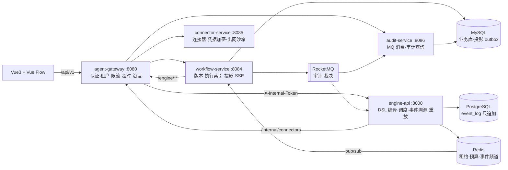

# AgentFlow 架构设计

一页式架构总览：系统边界、关键链路与设计原则。完整 DDL、DSL Schema、错误码目录、API 契约与实现期对齐记录按主题拆到分册，索引见 [docs/README.md](README.md)。

## 1. 系统边界

控制面（Java 17 / Spring Boot 多模块）负责认证、租户、工作流版本、执行索引、触发调度与审计；数据面（Python / FastAPI）负责 DSL 编译、拓扑调度、节点执行与事件溯源。前端只访问网关；Java 只经网关内部路由调用引擎；引擎的工具与模型调用再经网关转发到连接器服务。**引擎不持有任何明文凭据，也不直接出网。**

| 组件 | 端口 | 职责 |
|---|---|---|
| agent-gateway | 8080 | 唯一对外入口；`/api/v1/**` 业务路由，`/engine/**` 仅服务间 |
| workflow-service | 8084 | 工作流 CRUD、版本冻结、执行索引、事件投影、SSE Hub、触发器 |
| connector-service | 8085 | 连接器目录、AES-256-GCM 凭据、OAuth2、出网沙箱、MCP |
| audit-service | 8086 | MQ 消费与只追加审计查询 |
| engine-api | 8000 | 仅内网可达；所有请求要求 `X-Internal-Token` |
| 前端 dev | 5174 | Vite，代理到 8080（避开常被占用的 5173） |

## 2. 三条关键链路

**执行触发**：画布运行先保存草稿，再冻结同 checksum 的版本快照并显式带 `versionId` 触发；网关做租户解析、限流、预算钳制与 deadline 注入；引擎编译 DSL、按拓扑分层调度，命令与结果成对落事件。执行状态的唯一真相是 PostgreSQL 事件流，MySQL 的 `execution` / `node_execution` 只是查询投影。

**事件回流**：三条通道各司其职——权威投影由 workflow-service 轮询 `GET /internal/events?afterSeq=`（游标存 MySQL），实时推送由引擎追加事件后发 Redis 频道、SSE Hub 订阅扇出（断线用 `afterSeq` 追平），审计兜底由 Projector 转发 RocketMQ。SSE 不依赖 MQ 即可低延迟，MQ 只兜审计。

**工具与凭据**：引擎发出 `ToolCommand`，经网关转给 connector-service 执行。凭据只在 connector-service 解密，Python 全程不见明文。外部副作用按 `callId = executionId/nodeKey/attempt` 确定性幂等；Redis 租约处理并发冲突，整体语义为 at-least-once。

## 3. 设计原则

- **事件即唯一真相**：状态由事件流推导，业务表只是投影；崩溃恢复靠 checkpoint 与事件重放，不靠修复业务行。
- **幂等先于重试**：凡有副作用就先定幂等键，重试与补偿都建立在同一键上。
- **凭据不出控制面**：数据面零明文、零直连外网；出网统一走域名白名单加解析期私网拦截。
- **故障显式报错**：模型、向量库、精排未配置时返回明确错误码，不静默回落到示例输出。
- **契约单源**：OpenAPI 基线入库并做漂移门禁；DSL 文法在画布、发布期引擎校验、运行期求值三处共用同一实现口径。
- **预算硬停止**：发出命令前预占并把 `maxTokens` 钳到剩余额度，结算后回冲。

## 4. 分册导航

| 分册 | 内容 |
|---|---|
| [架构决策记录](02-design/decisions.md) | 调用路径、事件回流、恢复、灰度、表达式安全等 11 项取舍及理由 |
| [系统架构与模块边界](02-design/system-and-modules.md) | 完整组件图、Maven 模块依赖方向、Python 包与前端分层 |
| [数据模型](02-design/data-model.md) | MySQL 与 PostgreSQL 完整 DDL、Flyway 迁移约束 |
| [API 契约](02-design/api-contract.md) | 对外 `/api/v1` 与内部 `/engine/**` 契约 |
| [执行引擎](02-design/execution-engine.md) | 状态机、事件目录、重放协议、调度、租约、预算与 Provider |
| [DSL 与契约](02-design/dsl-and-contracts.md) | DSL Schema、编译期校验、节点输出契约、错误码、可观测 |
| [实现期对齐记录](00-infra/implementation-log.md) | 各阶段落地记录与偏差修正，按时间顺序归档 |
| [变更日志完整历史](00-infra/CHANGELOG-detailed.md) | 逐条变更明细 |
| [OpenAPI 基线](openapi/) | 引擎与四个 Java 服务的入库 spec |
| [产品指南](product-guide.md) | 功能矩阵、界面操作、模型清单 |
| [已知限制](known-limitations.md) | 能力边界与有意取舍 |

## 5. 能力边界

15 条边界与取舍逐条记录在 [已知限制](known-limitations.md)。实现与本文冲突时，先改文档再改代码。
